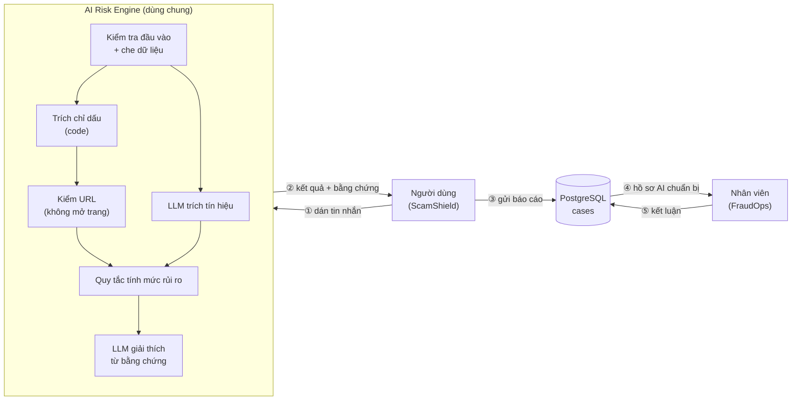

# ScamShield Ops

From Scam Reports to AI-Assisted Fraud Investigation.

Một sản phẩm, hai giao diện, dùng chung một AI engine:

- **ScamShield** (người dùng): dán tin nhắn đáng ngờ, nhận trong vài giây đánh giá rủi ro **có lý do**: tín hiệu nào được phát hiện, đâu là kiểm tra thực tế, đâu là nhận định của AI, nên làm gì tiếp. Không đủ bằng chứng thì hệ thống nói *chưa kết luận được*, không bao giờ nói "an toàn".
- **FraudOps** (nhân viên vận hành fintech): mỗi báo cáo từ người dùng đến dưới dạng **hồ sơ điều tra có cấu trúc** do AI chuẩn bị. Nhân viên xem bằng chứng, đưa ra kết luận và đóng hồ sơ.

> MoMo Tech Talent 2026 · *Imagine the Future Workspace (Human Centered. AI Powered)* · Chủ đề: **Chống lừa đảo**, **Trợ lý AI**

**Ví dụ.** Người dùng dán: *"[Ví XYZ] Tài khoản của bạn sẽ bị khoá trong 2 giờ. Xác minh ngay tại vi-xac-minh.example và nhập mã OTP vừa nhận."*

- **ScamShield trả lời** (minh hoạ): **Nguy cơ cao**, vì tên miền không thuộc tên miền chính thức của thương hiệu được nhắc tới *(Kiểm tra)*, tin tạo áp lực thời gian và đòi mã OTP *(AI nhận định)*. Nên làm: không bấm đường dẫn, không đưa OTP, liên hệ ví qua kênh chính thức, gửi báo cáo.
- **FraudOps nhận** hồ sơ `SC-0007`: nội dung đã che dữ liệu nhạy cảm, chỉ dấu `vi-xac-minh.example` kèm kết quả từng phép kiểm, tóm tắt 3–5 câu. Nhân viên chọn kết luận và ghi lý do.

## Hệ thống chạy thế nào



**Đọc hình theo số:**

1. **Gửi.** Người dùng dán tin nhắn. Hệ thống kiểm độ dài, che OTP/mật khẩu của nạn nhân, giữ lại chỉ dấu của bên gửi (URL, số điện thoại, số tài khoản).
2. **Phân tích.** Code tất định trích chỉ dấu và kiểm URL (tên miền giả thương hiệu, punycode, subdomain, link rút gọn) **mà không mở trang**. LLM trích tín hiệu ngữ nghĩa (áp lực thời gian, yêu cầu OTP, mạo danh). Mức rủi ro do **quy tắc** tính, rồi LLM viết giải thích chỉ dựa trên bằng chứng đã có.
3. **Báo cáo.** Người dùng bấm gửi, hệ thống tạo hồ sơ `SC-xxxx`.
4. **Hồ sơ.** FraudOps nhận hồ sơ đã có bằng chứng, kết quả kiểm và tóm tắt điều tra.
5. **Kết luận.** Nhân viên chọn *Xác nhận lừa đảo*, *Không phát hiện lừa đảo* hoặc *Chưa đủ bằng chứng*, kèm lý do.

**Vì sao tin được:**

- **AI đề xuất, con người quyết định.** Hệ thống không tự khoá tài khoản hay chặn giao dịch.
- **Mức rủi ro không do LLM tự nói.** LLM trích tín hiệu và viết giải thích; con số cuối cùng do quy tắc minh bạch, có test.
- **Mỗi tín hiệu ghi rõ nguồn:** *Kiểm tra* (code) hay *AI nhận định*.
- **Không chắc thì nói không chắc** (`inconclusive`).

## Cấu trúc repo

| Thư mục | Nội dung |
|---|---|
| `apps/web` | Next.js: giao diện ScamShield, FraudOps và API (route handlers), deploy một lần lên Vercel. Hiện có trang skeleton, `/api/health` và `POST /api/analyses` |
| `packages/core` | Nghiệp vụ không phụ thuộc Next.js, eval gọi trực tiếp. Hiện có: DB (schema 9 bảng, migration), HTTP client có allowlist, client Groq, pipeline phân tích (che dữ liệu, chỉ dấu, kiểm URL, quy tắc verdict, giải thích, lưu, rate limit), báo cáo, hồ sơ, đăng nhập, kết luận, danh sách chỉ dấu đã xác minh (dùng khi phân tích). Chưa có: tra cứu ngoài (T-035) |
| `packages/shared` | Zod schema (request/response, đầu ra LLM), mã lỗi kèm câu tiếng Việt |
| `eval` | Bộ tình huống có nhãn (`eval/cases/`, hiện 20 câu dev nháp) và script đánh giá (`npm run eval -- --set dev` cho cả pipeline, `npm run eval:q08` cho thử model) |
| `docs` | Tài liệu sản phẩm và kỹ thuật, viết bằng tiếng Việt |
| `tools/sdlc-kit` | Submodule quy trình SDLC cho coding agent ([my-sdlc-kit](https://github.com/AkiraTomori/my-sdlc-kit)) |

**Trạng thái (27/11/2026):** đã có nền móng, schema dữ liệu, phần gọi LLM (PR #2–#4), pipeline phân tích (S3) và `POST /api/analyses` (PR #46). Chưa deploy, chưa có giao diện ScamShield, báo cáo hay FraudOps. Chi tiết: [`docs/README.md`](docs/README.md#trạng-thái); lộ trình: [`docs/runbook/plan.md`](docs/runbook/plan.md).

## Quy trình làm việc (sdlc-kit)

Quy trình SDLC cho Claude Code nằm ở submodule `tools/sdlc-kit`. Luật riêng của dự án ở [`AGENTS.md`](AGENTS.md).

```bash
# Clone kèm submodule
git clone --recurse-submodules https://github.com/AkiraTomori/ScamShield-Ops
# hoặc, nếu đã clone:
git submodule update --init

# Cài plugin (một lần mỗi máy)
claude plugin marketplace add ./tools/sdlc-kit
claude plugin install sdlc@sdlc-kit --scope project
claude plugin list
```

Nâng phiên bản quy trình:

```bash
git submodule update --remote tools/sdlc-kit
git add tools/sdlc-kit && git commit -m "chore: update sdlc-kit"
```

## Cách chạy

Cần Node.js ≥ 22 (`.nvmrc`: 24) và Docker.

```bash
cp .env.example .env     # rồi đổi POSTGRES_PASSWORD, và cùng mật khẩu đó trong DATABASE_URL
docker compose up -d --wait
npm ci
npm run dev              # http://localhost:3000, kiểm tra: /api/health
npm run verify           # format + lint + typecheck + test
npm run e2e:setup        # một lần: DB local và .env.e2e cho E2E
npm run test:e2e         # luồng demo bằng Playwright (xem setup-and-bringup §1)
```

Đổi API key (ví dụ `GROQ_API_KEY`): sửa `.env`, khởi động lại `npm run dev`. Chi tiết ở [`docs/runbook/setup-and-bringup.md`](docs/runbook/setup-and-bringup.md).

## Công nghệ, tài sản có sẵn và công cụ AI

*Theo yêu cầu bài nộp; cập nhật dần khi thêm vào dự án.*

| Loại | Tên | Dùng để |
|---|---|---|
| Framework | Next.js, Node.js, TypeScript | Web và API |
| Font | [Be Vietnam Pro](https://fonts.google.com/specimen/Be+Vietnam+Pro) (SIL Open Font License), tải lúc build và tự phục vụ qua `next/font` | Chữ giao diện |
| Cơ sở dữ liệu | PostgreSQL (Supabase managed) | Analyses, cases, decisions |
| Mô hình AI | Groq: `qwen/qwen3.8-27b` (chính), `openai/gpt-oss-120b` (dự phòng), chốt sau thử nghiệm Q-08 | Trích tín hiệu, giải thích, tóm tắt hồ sơ |
| Thư viện mã nguồn mở | React, Tailwind CSS, zod, Drizzle ORM, postgres.js, Vitest, Playwright, ESLint, Prettier, tsx, tldts (phiên bản ghim trong `package.json`) | Giao diện, schema, truy cập DB, test, chất lượng mã |
| Dữ liệu công bố | [PeterDaveHello/url-shorteners](https://github.com/PeterDaveHello/url-shorteners) (CC BY-SA 4.0, trích một phần); [bảng xếp hạng TLD của Interisle, 5/2025–4/2026](https://www.cybercrimeinfocenter.org/phishing-activity-in-tlds-may-april-2026) | Danh sách dịch vụ rút gọn và TLD rủi ro trong `packages/shared/data/url-lists.json` |
| Công cụ AI hỗ trợ phát triển | Claude Code + [my-sdlc-kit](https://github.com/AkiraTomori/my-sdlc-kit) | Viết spec, thiết kế, mã và test |

## Đọc tiếp

| Bạn là | Đọc |
|---|---|
| Giám khảo, người mới | [`docs/product/pitch.md`](docs/product/pitch.md) (5 phút), rồi [`docs/onboarding/concepts.md`](docs/onboarding/concepts.md) nếu cần giải thích thuật ngữ |
| Người viết code, agent | [`AGENTS.md`](AGENTS.md), rồi [`docs/spec/ScamShield-v1.md`](docs/spec/ScamShield-v1.md) |
| Muốn xem hết | [`docs/README.md`](docs/README.md) |

*Kết quả mang tính tham khảo. Hãy xác minh qua kênh chính thức của tổ chức trước khi chuyển tiền hoặc cung cấp thông tin.*
