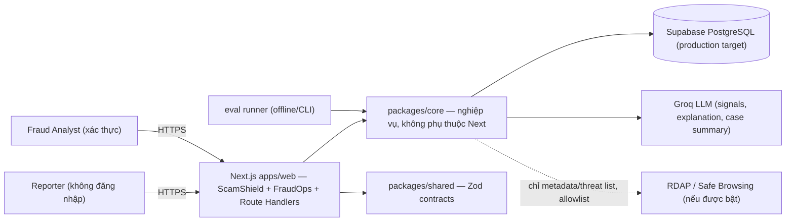
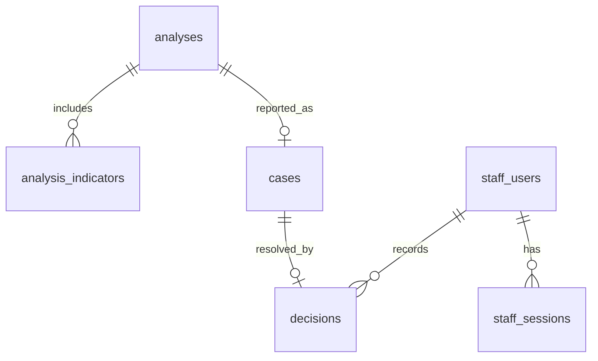

# ScamShield Ops — Architecture Overview

**Trạng thái:** Tóm tắt kiến trúc đích (24/11/2026), **không phải một thiết kế mới được phê duyệt**. **Nguồn sự thật:** [system-design.md](system-design.md), [contracts.md](contracts.md), [api.md](api.md), [data-model.md](data-model.md), [analysis-pipeline.md](../design/analysis-pipeline.md). Khi lệch, xem [thứ tự ưu tiên](../README.md#khi-các-file-lệch-nhau). Các bước được mô tả ở đây có thể **chưa được implement**.

## 1. Context và ranh giới trust



**Một project Next.js trên Vercel** được chọn theo D-01; local có Docker PostgreSQL. `packages/core` dùng chung giữa API và runner; `packages/shared` chứa schema. Không microservices, queue hoặc framework agent chỉ để thêm độ phức tạp. **Không tích hợp ví/bank thật.**

## 2. Data flow và thứ tự xử lý

```mermaid
sequenceDiagram
  participant U as Reporter
  participant R as Next.js API
  participant C as Core Analysis
  participant L as Groq
  participant D as PostgreSQL
  participant A as Fraud Analyst
  U->>R: POST /api/analyses (text)
  R->>C: validate + rate limit
  C->>C: redact victim secrets; extract indicators; check URL string
  C->>L: extract semantic signals (redacted content)
  L-->>C: schema-validated signals/evidence
  C->>C: deterministic verdict + recommendations
  C->>L: explanation based on evidence only
  C->>D: persist redacted analysis
  C-->>U: verdict + signals + recommendation
  U->>R: submit report
  R->>D: idempotent case (pending_review)
  R->>L: prepare case summary
  A->>R: login → list/detail case
  R->>D: read evidence and state
  A->>R: decision + reason
  R->>D: append decision and close case
```

Sơ đồ là **workflow nghiệp vụ đích**. Trong thiết kế pipeline, tra cứu ngoài có thể chạy song song với bước LLM; khi lỗi/timeout phải ghi unavailable, không được đánh đồng với safe. Phần case summary có thể null khi LLM lỗi, human analyst vẫn xử lý case được [SO-05](../spec/ScamShield-v1.md).

## 3. Domain data và invariants



**Các bảng P0** theo [Data Model](data-model.md): `analyses`, `analysis_indicators`, `cases`, `decisions`, `staff_users`, `staff_sessions`, `rate_limit_counters`, `llm_daily_usage`. **Không có bảng reports riêng**: report được đại diện bởi `cases` (DB-01). `analyses` và `decisions` là bản ghi bất biến; mỗi analysis có tối đa một case, mỗi case tối đa một decision. `cases` chuyển `pending_review → closed`.

## 4. Security and data boundaries

| Boundary | Contract |
|---|---|
| Browser → API | Validate bằng Zod, giới hạn 2.000 ký tự, rate limit, auth trên /ops |
| Untrusted text → LLM | Che OTP/mật khẩu/thẻ trước khi gửi; phân tách user text thành data; không nhận chỉ dẫn trong tin nhắn |
| LLM → risk engine | Schema check, evidence check, không cho LLM tự đặt verdict |
| Indicator URL → external | Không mở/render/crawl URL; chỉ xử lý string + dịch vụ metadata allowlist khi bật |
| API → DB | Lưu bản đã che, sử dụng constraints/transactions; credentials ở server env |
| Analyst → case decision | Auth, lý do bắt buộc; quyết định có thể khác engine verdict |

**Threats cần kiểm thử:** prompt injection, false positives với OTP hợp lệ, homograph/punycode, SSRF, rate-limit bypass, 429/timeout, concurrent case closure, lộ secret, leakage qua logs; xem [Spec](../spec/ScamShield-v1.md) và [Analysis Pipeline](../design/analysis-pipeline.md).

## 5. Architectural decisions and trade-offs

| Decision | Lựa chọn | Vì sao / đổi lại |
|---|---|---|
| D-01 | Một Next.js App Router + Route Handlers | Triển khai nhanh; đổi lại API gắn vòng đời Next.js |
| D-02 | Drizzle + postgres.js, ESLint/Prettier | SQL/schema rõ, nhẹ; phải cấu hình connection pooler đúng |
| D-03 | Preview không kết nối production DB | Tránh dữ liệu preview can thiệp production; preview /api/health có thể 503 |
| Q-08 | Groq Qwen chính, GPT-OSS 120B dự phòng | Đã thử S2; dự phòng yếu hơn về injection và tiếng Việt |
| P4/P5 | Rules verdict, không mở URL | Tăng kiểm soát, nhưng không phát hiện được toàn bộ nội dung/redirect web |
| D-04/D-05 | Rủi ro Supabase free pause và deploy hoãn | **Chưa được giải quyết hoàn toàn**; kiểm nghiệm sớm trước hạn nộp |

**Không phải Agentic AI tự chủ:** không có tool-selection loop cho model, multi-agent hay action tự khóa tài khoản. “Trợ lý AI” thể hiện qua hỗ trợ chuẩn bị và giải thích hồ sơ điều tra.

## 6. Deployment, observability và test gates

- **Local:** Docker PostgreSQL, `npm ci`, `npm run verify`; không cần Kubernetes.
- **Production target:** Vercel Node.js runtime + Supabase transaction pooler, env variables được owner cấu hình; migration chạy thủ công, không chạy trong build.
- **CI:** format/lint/typecheck/Vitest. E2E cần xác thực report → case → decision → reload.
- **Evaluation:** runner gọi cùng `packages/core`, giữ model/prompt/rules version, gắn commit và số đo đầy đủ. [Evaluation Protocol](../research/evaluation-protocol.md).
- **Metrics quan trọng:** p50/p95 end-to-end, tỷ lệ correct schema, false-positive, `inconclusive`, 429/unavailable, log an toàn; không ghi PII/raw URL hay API key vào log.
- **Open issues:** deploy public, verify function timeout/DB pooling, seed/reset, credential issuance, data retention policy, 60–100 sample held-out evaluation.

## 7. Implementation path và trạng thái

**Đã được báo cáo hoàn thành:** foundation PR #2, DB migration PR #3, model spike PR #4. **Chưa có bằng chứng hoàn thành:** toàn bộ pipeline, UI public analysis, report/case/auth/decision, public deploy và held-out eval. Nhìn theo kế hoạch: S3 analysis API → ScamShield UI → report/case → FraudOps decision → deploy/eval/video. Theo [Runbook](../runbook/plan.md), đóng băng tính năng mục tiêu 30/11, nộp 03/12.

Tài liệu này **chỉ hệ thống hóa điều đã có**; mọi thay đổi hành vi phải cập nhật [Spec](../spec/ScamShield-v1.md) trước.
