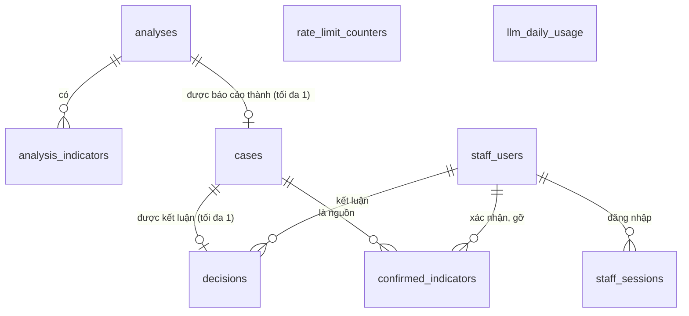

# ScamShield Ops — Mô hình dữ liệu

**Trạng thái (28/11/2026):** thêm bảng `confirmed_indicators` (§2.9, migration `0001_confirmed_indicators`, T-082, đã merge (PR #53), đã chạy trên Supabase, kiểm 28/11). Phần P0: ĐÃ DUYỆT để triển khai (owner duyệt 21/11/2026). Schema Drizzle và migration `0000_p0_tables` đã viết, đã chạy trên Postgres local (DB tạm trong test tích hợp; 77 test xanh ngày 21/11, gồm CHECK `analyses_inconclusive_has_reason` của DB-06); **đã chạy trên Supabase** (kiểm 28/11); migrate DB deploy chỉ owner làm (plan §5). Seed và reset demo (§7) xong ở local 28/11 (T-090, PR #54, chưa merge; seed đã chạy trên Supabase, kiểm 28/11; [demo-data §10](../design/demo-data.md#10-ghi-chú-cài-đặt-t-090-28112026)). Quyết định ở §9: DB-01…DB-04, DB-06, O-04 đã chốt; DB-05 là đề xuất.

**Căn cứ:**
- [spec §10](../spec/ScamShield-v1.md#10-ảnh-hưởng-tới-dữ-liệu-và-api-mức-đặc-tả)
- [contracts](./contracts.md), [api.md](./api.md)
- [design/analysis-pipeline §3, §10](../design/analysis-pipeline.md)
- [system-design §4](./system-design.md#4-truy-cập-dữ-liệu): RLS, pooler, migration

**P1:** bảng chỉ dấu đã xác minh (SO-08) ở §2.9, thiết kế slice ở [design/verified-indicators](../design/verified-indicators.md).

## 1. Thực thể và ai sở hữu dữ liệu

| Thực thể | Nghĩa | Ai tạo / sửa | Vòng đời |
|---|---|---|---|
| `analyses` | Một lượt phân tích đã qua bước kiểm đầu vào | Pipeline tạo; **không bao giờ sửa** | Bất biến |
| `analysis_indicators` | Chỉ dấu đã chuẩn hoá của một analysis, dùng để so khớp (SO-07) | Pipeline, cùng giao dịch với analysis | Bất biến |
| `cases` | Hồ sơ = báo cáo của người dùng (DB-01) | Người dùng tạo qua `/report`; nhân viên chỉ đổi trạng thái | `pending_review` → `closed`, không quay lại |
| `decisions` | Kết luận của nhân viên | Nhân viên, một lần | Bất biến |
| `staff_users` | Tài khoản FraudOps | Lệnh seed của owner | Không có đăng ký |
| `staff_sessions` | Phiên đăng nhập | Đăng nhập tạo, đăng xuất xoá | Hết hạn sau thời gian cố định |
| `rate_limit_counters` | Bộ đếm theo IP đã băm, cửa sổ 1 phút | Middleware rate limit | Xoá sau 1 giờ |
| `llm_daily_usage` | Số lời gọi LLM trong ngày (P-03) | Module `llm` | Một dòng mỗi ngày |
| `confirmed_indicators` | Chỉ dấu nhân viên đã xác nhận là lừa đảo (SO-08, P1) | Giao dịch kết luận tạo; nhân viên gỡ | Gỡ là xoá mềm; xác nhận lại tạo dòng mới |

## 2. Bảng

Quy ước chung:
- Khoá chính UUID (sinh ở app hoặc `gen_random_uuid()`).
- Thời điểm là `timestamptz`, lưu UTC.
- Giá trị enum dùng `text` + `CHECK`, không dùng kiểu enum của Postgres: thêm giá trị chỉ cần sửa CHECK, không phải `ALTER TYPE`.
- Tên cột `snake_case`; Drizzle ánh xạ sang `camelCase` (conventions/contracts §3).
- **Mọi bảng bật RLS và không có policy** (§6).

### 2.1 `analyses`

| Cột | Kiểu | Ràng buộc / ghi chú |
|---|---|---|
| `id` | uuid | PK |
| `redacted_content` | text | NOT NULL. **Chỉ bản đã che**. CHECK `char_length ≤ 4000` (đầu vào ≤ 2.000 ký tự, cộng phần dài thêm của nhãn che) |
| `redaction_counts` | jsonb | NOT NULL, `{otp, password, card}` |
| `verdict` | text | NOT NULL, CHECK ∈ 4 giá trị `Verdict` |
| `rule` | text | NOT NULL, mã quy tắc `R0`…`R9` |
| `inconclusive_reason` | text | NULL, CHECK ∈ `InconclusiveReason`. Có thể khác NULL kể cả khi verdict là `high_risk` (P-01). CHECK `verdict <> 'inconclusive' OR inconclusive_reason IS NOT NULL`: verdict `inconclusive` luôn có lý do (DB-06). Chiều ngược lại không ép |
| `risk_types` | text[] | NOT NULL, mặc định `{}` |
| `details` | jsonb | NOT NULL. `signals`, `indicators` (kèm `checks`), `explanation`, `recommendations`, đúng hình dạng contracts §2–§5. Parse bằng zod khi ghi **và** khi đọc (DB-02) |
| `prompt_version`, `rules_version` | text | NOT NULL |
| `model_signals`, `model_explain` | text | NULL khi bước LLM không chạy |
| `trace` | jsonb | NOT NULL. Độ trễ từng bước, số lần gọi LLM, `dropped_signals`. Chỉ dành cho eval, không trả qua API |
| `latency_ms` | integer | NOT NULL, CHECK ≥ 0 |
| `is_seed` | boolean | NOT NULL, mặc định false |
| `created_at` | timestamptz | NOT NULL, mặc định `now()` |

Index: `(created_at)`.

**Không có cột** nào cho nội dung gốc, IP, user agent hay header.

### 2.2 `analysis_indicators`

| Cột | Kiểu | Ràng buộc / ghi chú |
|---|---|---|
| `analysis_id` | uuid | FK → `analyses.id` ON DELETE CASCADE |
| `type` | text | CHECK ∈ `domain`, `phone`, `bank_account` |
| `normalized` | text | NOT NULL, chuẩn hoá theo analysis-pipeline §6.1–6.3 |

- PK `(analysis_id, type, normalized)`. Index `(type, normalized)` để tìm hồ sơ liên quan (SO-07) và tra chỉ dấu đã xác minh (SO-08).
- Chỉ dấu `url` và `brand` không vào bảng này: SO-07-AC01 chỉ so tên miền, SĐT, số tài khoản. Bản đầy đủ nằm trong `analyses.details`.

### 2.3 `cases`

| Cột | Kiểu | Ràng buộc / ghi chú |
|---|---|---|
| `id` | uuid | PK |
| `code` | text | NOT NULL, UNIQUE, CHECK khớp `^SC-[0-9]{4,}$` (DB-03) |
| `analysis_id` | uuid | NOT NULL, **UNIQUE** (SO-04-AC03), FK → `analyses.id` ON DELETE RESTRICT |
| `status` | text | NOT NULL, CHECK ∈ `pending_review`, `closed`, mặc định `pending_review` |
| `channel` | text | NOT NULL, CHECK ∈ `ReportChannel` |
| `reporter_note` | text | NULL, CHECK `char_length ≤ 1000`: người dùng nhập tối đa 500 ký tự (O-04), nhãn che làm chuỗi dài thêm (RP-01, owner chốt 26/11; đã sửa thẳng `0000_p0_tables` 27/11, đã merge, PR #50) |
| `secret_hash` | text | NOT NULL. Băm scrypt của mã bí mật, có muối và tham số trong chuỗi. Mã gốc không bao giờ được lưu |
| `engine_verdict` | text | NOT NULL. **Bản chụp** verdict của analysis lúc tạo case, để lọc danh sách không cần join. Analysis bất biến nên không lệch |
| `risk_types` | text[] | NOT NULL, bản chụp như trên |
| `ai_summary` | jsonb | NULL khi LLM lỗi (A-02), dạng `{summary, nextSteps}` |
| `summary_prompt_version` | text | NULL |
| `is_seed` | boolean | NOT NULL, mặc định false |
| `created_at`, `updated_at` | timestamptz | NOT NULL |
| `closed_at` | timestamptz | NULL. CHECK `(status = 'closed') = (closed_at IS NOT NULL)` |

Index:
- `(status, created_at DESC)`: hàng đợi mặc định.
- `(engine_verdict, created_at DESC)`: lọc theo verdict.

`code` là duy nhất nên tìm theo mã dùng luôn index UNIQUE.

### 2.4 `decisions`

| Cột | Kiểu | Ràng buộc / ghi chú |
|---|---|---|
| `case_id` | uuid | PK (tối đa một kết luận cho mỗi case), FK → `cases.id` ON DELETE CASCADE |
| `decision` | text | NOT NULL, CHECK ∈ `Decision` |
| `reason` | text | NOT NULL, CHECK `char_length BETWEEN 10 AND 500` (O-04) |
| `decided_by` | uuid | NOT NULL, FK → `staff_users.id` ON DELETE RESTRICT |
| `decided_at` | timestamptz | NOT NULL |
| `engine_verdict` | text | NOT NULL, bản chụp lúc kết luận |
| `disagrees_with_engine` | boolean | NOT NULL, tính theo bảng đồng ý SO-06-AC04 ở code, lưu lại cho eval |

### 2.5 `staff_users`

| Cột | Kiểu | Ràng buộc / ghi chú |
|---|---|---|
| `id` | uuid | PK |
| `username` | text | NOT NULL, UNIQUE, CHECK `username = lower(username)` và khớp `^[a-z0-9_]{3,32}$` |
| `display_name` | text | NOT NULL |
| `password_hash` | text | NOT NULL, scrypt (backend.md §7) |
| `is_demo` | boolean | NOT NULL. Tài khoản `judge1…judge5` (Q-07) |
| `disabled_at` | timestamptz | NULL. Khác NULL thì không đăng nhập được |
| `created_at` | timestamptz | NOT NULL |

### 2.6 `staff_sessions` (DB-04)

| Cột | Kiểu | Ràng buộc / ghi chú |
|---|---|---|
| `token_hash` | text | PK. SHA-256 của token ngẫu nhiên 32 byte; cookie chứa token gốc, DB chỉ chứa băm |
| `staff_user_id` | uuid | FK → `staff_users.id` ON DELETE CASCADE |
| `created_at`, `expires_at` | timestamptz | NOT NULL. Hết hạn đề xuất 12 giờ |

Index `(expires_at)` để dọn phiên hết hạn.

### 2.7 `rate_limit_counters`

| Cột | Kiểu | Ràng buộc / ghi chú |
|---|---|---|
| `key` | text | HMAC-SHA256 hex của IP (analysis-pipeline §3), kèm tiền tố phạm vi (`pub:` cho nhóm công khai, `login:` cho đăng nhập) |
| `window_start` | timestamptz | Đầu phút |
| `count` | integer | NOT NULL, CHECK ≥ 1 |

- PK `(key, window_start)`.
- Tăng bằng **một** câu: `INSERT … VALUES (k, w, 1) ON CONFLICT (key, window_start) DO UPDATE SET count = rate_limit_counters.count + 1 RETURNING count`.
- Dọn: trong khoảng 1/50 số request (chọn ngẫu nhiên), xoá dòng có `window_start < now() - interval '1 hour'`. Không cần cron, nên chạy được cả khi chưa deploy (D-05).

### 2.8 `llm_daily_usage`

| Cột | Kiểu | Ràng buộc / ghi chú |
|---|---|---|
| `day` | date | PK. Ngày theo giờ Việt Nam, app tính rồi truyền vào |
| `calls` | integer | NOT NULL, CHECK ≥ 0 |

Giữ chỗ trước mỗi lời gọi LLM: tạo dòng nếu chưa có, rồi `UPDATE … SET calls = calls + 1 WHERE day = $1 AND calls < $cap RETURNING calls`. Không có dòng trả về nghĩa là đã chạm trần, và bước LLM bị bỏ (P-03). Không đặt `LLM_DAILY_CALL_CAP` thì bỏ qua bảng này.

### 2.9 `confirmed_indicators` (SO-08, P1, migration `0001_confirmed_indicators`)

| Cột | Kiểu | Ràng buộc / ghi chú |
|---|---|---|
| `id` | uuid | PK |
| `type` | text | NOT NULL, CHECK ∈ `domain`, `phone`, `bank_account` |
| `normalized` | text | NOT NULL, cùng dạng với `analysis_indicators` |
| `source_case_id` | uuid | NOT NULL, FK → `cases.id` ON DELETE RESTRICT |
| `confirmed_by` | uuid | NOT NULL, FK → `staff_users.id` ON DELETE RESTRICT |
| `confirmed_at` | timestamptz | NOT NULL, bằng `decided_at` của kết luận |
| `removed_at` | timestamptz | NULL |
| `removed_by` | uuid | NULL, FK → `staff_users.id` ON DELETE RESTRICT (hành động xoá: T-082 chọn, **chờ owner xác nhận**) |
| `removal_reason` | text | NULL, CHECK `char_length BETWEEN 10 AND 500` |

- CHECK: `removed_at`, `removed_by`, `removal_reason` cùng NULL hoặc cùng khác NULL.
- UNIQUE một phần `(type, normalized) WHERE removed_at IS NULL`; cũng phục vụ tra cứu của engine (T-080).
- Không bao giờ ghi tên miền chính thức của thương hiệu hay tên miền rút gọn (SO-08-AC01, XM-01).

## 3. Bất biến và nơi bảo đảm

| Bất biến | Bảo đảm bằng |
|---|---|
| Mỗi analysis có tối đa một case (SO-04-AC03) | UNIQUE `cases.analysis_id` |
| Mỗi case có tối đa một kết luận | PK `decisions.case_id` |
| Case `closed` ⇔ có `closed_at` | CHECK trên `cases` |
| Case `closed` ⇔ có `decisions` | Giao dịch đóng hồ sơ (§4). Postgres không CHECK chéo bảng được; có test tích hợp |
| Không lưu nội dung gốc, IP thô, mã bí mật gốc, mật khẩu gốc, token phiên gốc | Không có cột cho chúng; review |
| Analysis và chỉ dấu không đổi sau khi tạo | Không có đường code `UPDATE`; FK RESTRICT ngăn xoá analysis còn case |
| Verdict `inconclusive` luôn kèm lý do (DB-06) | CHECK trên `analyses`. Mọi quy tắc cho ra `inconclusive` đều có lý do (design/analysis-pipeline §7: R0, R8) |
| Mỗi chỉ dấu có tối đa một dòng đã xác minh chưa gỡ (SO-08) | UNIQUE một phần trên `confirmed_indicators` |
| Case `confirmed_scam` không thiếu chỉ dấu đã xác minh | Ghi trong cùng giao dịch kết luận; có test tích hợp rollback |
| Giá trị enum hợp lệ | CHECK + zod |
| JSON đúng hình dạng | zod khi ghi và khi đọc (DB-02) |

## 4. Giao dịch và thao tác đồng thời

| Thao tác | Trong một giao dịch | Đồng thời |
|---|---|---|
| Lưu analysis | `INSERT analyses` + `INSERT analysis_indicators` | Không tranh chấp |
| Gửi báo cáo | Sinh mã bí mật → `INSERT cases`. Tóm tắt AI gọi **trước** giao dịch, không giữ giao dịch mở trong lúc chờ LLM | Hai request cùng analysis: một bên vi phạm UNIQUE (`23505`), bắt lỗi rồi đọc case đã có, trả `alreadyReported: true` |
| Kết luận | `UPDATE cases SET status='closed', closed_at=now(), updated_at=now() WHERE code=$1 AND status='pending_review' RETURNING id` → không có dòng: đọc kết luận hiện có, trả 409 → có dòng: `INSERT decisions` → nếu `confirmed_scam`: `INSERT confirmed_indicators … ON CONFLICT DO NOTHING` (SO-08-AC01) | Hai nhân viên cùng lúc: chỉ một `UPDATE` khớp điều kiện. Hai hồ sơ chung chỉ dấu: chèn theo thứ tự cố định, dòng đến sau bị bỏ qua |
| Gỡ chỉ dấu | Một `UPDATE … WHERE id = $1 AND removed_at IS NULL`; không có dòng thì đọc lại để phân biệt 409 và 404 | Hai người gỡ cùng lúc: chỉ một `UPDATE` khớp |
| Rate limit | Một câu upsert (§2.7) | Nguyên tử ở mức dòng |
| Trần LLM | Một câu update có điều kiện (§2.8) | Nguyên tử ở mức dòng |
| Đăng nhập | `INSERT staff_sessions` | Không tranh chấp |

Ghi thất bại thì giao dịch rollback toàn bộ: không có case thiếu analysis, không có case `closed` thiếu kết luận.

**Chạy qua transaction pooler:** giao dịch ngắn chạy được bình thường. Không dùng prepared statement (đã tắt ở `createDatabase`), không dùng `LISTEN`, advisory lock theo session hay `SET` kéo dài qua nhiều câu lệnh.

## 5. Mã hồ sơ (DB-03)

- Sequence `case_code_seq` bắt đầu từ **101**, `MAXVALUE 9999` (`lpad` chỉ đệm tới 4 chữ số; chạm trần thì `nextval` báo lỗi thay vì cắt cụt mã). Case thật nhận mã `'SC-' || lpad(nextval::text, 4, '0')` → `SC-0101`, `SC-0102`, …
- Case mẫu (`is_seed`) dùng mã cố định `SC-0001`…`SC-0040` do lệnh seed gán. Nhờ vậy reset vẫn giữ đúng mã, và hướng dẫn hay video có thể nhắc tới một mã mẫu cụ thể.
- Sequence có thể có khoảng trống (giao dịch rollback); chấp nhận.

## 6. Bảo mật và quyền riêng tư

- **RLS:** `ENABLE ROW LEVEL SECURITY` trên mọi bảng, không có policy. Role của ứng dụng là owner của bảng nên không bị chặn; các role `anon`/`authenticated` của Supabase bị chặn. Đây là lớp thứ hai, sau việc tắt Data API (system-design §4). Nếu `drizzle-kit` không tự sinh câu lệnh RLS thì viết tay trong file migration và đọc lại trước khi commit.
- **Không lưu:** nội dung gốc, IP thô, mã bí mật gốc, mật khẩu gốc, token phiên gốc.
- **Băm:**
  - mật khẩu và mã bí mật: scrypt
  - IP: HMAC-SHA256 với `RATE_LIMIT_SALT`
  - token phiên: SHA-256 (token đã đủ ngẫu nhiên)
- **Thời gian giữ:**
  - `rate_limit_counters`: tối đa khoảng 1 giờ
  - `staff_sessions` hết hạn: xoá khi dọn
  - `analyses` không được báo cáo: giữ hết giai đoạn cuộc thi (DB-05)
- **Log:** không log giá trị cột nào ở trên (backend.md §6).

## 7. Seed và reset demo (SO-10-AC03, AC04, Q-07)

| Lệnh | Làm gì |
|---|---|
| `npm run demo:seed` | Upsert `judge1…judge5` (mật khẩu đọc từ biến `DEMO_STAFF_PASSWORDS` trong `.env` của owner, không nằm trong repo hay log); chèn 20–40 cặp analysis + case `is_seed` với mã `SC-0001…`, gồm 3 case cùng `vi-xac-minh.example` (demo.md S1), trạng thái và verdict trộn lẫn; một số case đã đóng có kết luận của `judge1` |
| `npm run demo:reset` | Một giao dịch: xoá `decisions` của case seed → xoá case seed → xoá analysis seed (chỉ dấu tự xoá theo cascade) → chèn lại như seed. **Không** đụng case, analysis hay kết luận không phải seed, và không đụng `staff_users` |

- Giám khảo kết luận trên một case seed thì kết luận đó mất khi reset. Chấp nhận: reset là để trả seed về trạng thái ban đầu.
- Analysis seed không chạy pipeline. Dữ liệu `details` soạn sẵn trong mã seed, dùng `*.example`, và phải qua cùng zod schema.
- **Thứ tự sau P1:** khi có bảng chỉ dấu đã xác minh (§8), reset cũng phải gỡ chỉ dấu sinh từ case seed, để `vi-xac-minh.example` không nằm sẵn trong danh sách trước khi quay (demo.md S2).

## 8. P1 và migration riêng

`confirmed_indicators` (owner duyệt S8 ngày 26/11) đã có ở §2.9. Lý do chọn cột và thứ tự reset ở [design/verified-indicators §4](../design/verified-indicators.md#4-bảng-confirmed_indicators-migration-0001_confirmed_indicators). Vì FK `source_case_id` là RESTRICT, `demo:reset` (T-090) phải xoá chỉ dấu sinh từ case seed **trước** khi xoá case seed.

## 9. Quyết định

| ID | Câu hỏi | Phương án | Quyết định |
|---|---|---|---|
| DB-01 | Spec §10 tách `reports` và `cases`. Cần hai bảng không? | (a) **Gộp**: một báo cáo luôn sinh đúng một case, không có báo cáo nào không thành case. Ít join, ít giao dịch. (b) Tách: đúng chữ spec, chừa chỗ cho nhiều báo cáo vào một case (ngoài v1) | **(a)**, owner chốt 20/11; đã sửa spec §10 |
| DB-02 | Lưu signal, chỉ dấu, check thế nào? | (a) **jsonb `details`** + zod khi ghi và đọc; chỉ tách bảng `analysis_indicators` vì cần truy vấn. (b) Chuẩn hoá thành bảng `signals`, `checks`: truy vấn SQL linh hoạt hơn nhưng nhiều bảng, nhiều join, migration nặng | **(a)**, owner chốt 20/11 |
| DB-03 | Mã hồ sơ | Case thật từ `SC-0101` (tối đa `SC-9999`), seed cố định `SC-0001…0040` | **Đồng ý**, owner duyệt 21/11 |
| DB-04 | Phiên đăng nhập lưu ở đâu? | (a) **Bảng `staff_sessions`**: đăng xuất thu hồi được phiên ngay. (b) Cookie ký không trạng thái: không cần bảng nhưng không thu hồi được | **(a)**, owner chốt 20/11 |
| DB-05 | Giữ analysis không được báo cáo bao lâu? | Giữ tới hết giai đoạn cuộc thi (eval và số liệu cần), sau đó xoá | Đề xuất; chốt ngày sau |
| DB-06 | Ép `inconclusive ⇒ có lý do` ở DB hay ở code? | (a) **CHECK ở DB**: lỗi pipeline không thể lưu một `inconclusive` không giải thích (giao diện không có câu cho trường hợp đó). Sửa thẳng `0000_p0_tables` vì chưa deploy. (b) Chỉ code ép | **(a)**, owner chốt 21/11 |
| O-04 | Độ dài ghi chú, lý do (CHECK ở §2.3, §2.4) | Ghi chú ≤ 500; lý do 10–500 | **Đồng ý**, owner chốt 20/11 |

## 10. Kế hoạch migration

1. Viết schema Drizzle trong `packages/core/src/db/schema/`. `npm run db:generate` sinh **một** migration cho mọi bảng P0, sequence và RLS. Drizzle đánh số từ `0000`, nên file là `0000_p0_tables.sql`. **Đọc lại file SQL** trước khi commit.
2. Chạy trên Postgres local (Docker), chạy test tích hợp: các bất biến ở §3, giao dịch ở §4, mã hồ sơ, RLS. Mỗi file test tạo một database tạm, áp migration từ đầu rồi xoá, nên không đụng DB dev. Seed và reset có test ở `packages/core/test/demo/` (T-090).
3. DB đã deploy: **chỉ owner** chạy `npm run db:migrate` với `DATABASE_URL_MIGRATE` (hiện hoãn theo D-05).
4. Không sửa `0000_p0_tables` sau khi đã chạy trên DB deploy; thay đổi sau viết migration mới (backend.md §3).
5. `0001_confirmed_indicators` chỉ thêm một bảng, index và RLS; không sửa bảng cũ. **Owner chạy trên DB deploy trước khi deploy mã của T-082.**
6. Trước khi có dữ liệu thật thì không cần kế hoạch rollback dữ liệu. Sau khi deploy, mọi migration phải chỉ thêm (thêm cột NULL được, thêm bảng), không xoá hay ghi đè dữ liệu.
