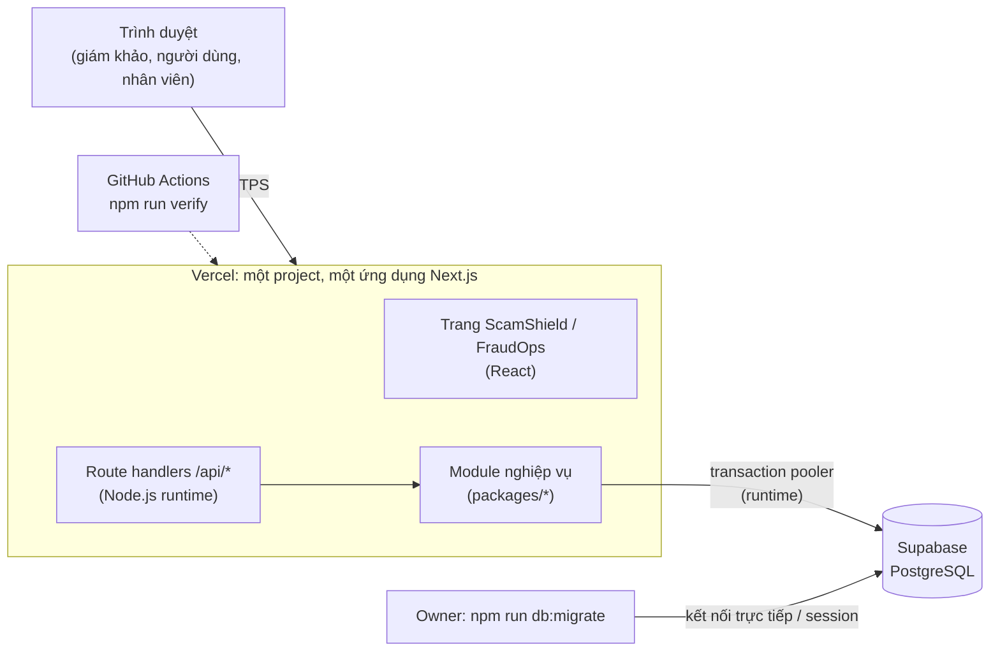

# ScamShield Ops — Thiết kế hệ thống

**Trạng thái (20/11/2026):** BẢN NHÁP. Mới thiết kế **slice nền móng + walking skeleton** (§1–§9). Các phần khác ghi "chưa thiết kế" ở §10. Owner đã chốt D-01…D-03 ngày 20/11/2026 (§9); D-04 còn chờ kiểm. Thiết kế đã chốt **chưa** phải duyệt slice: chỉ viết mã khi owner duyệt slice nền móng.

Căn cứ: [spec v1](../spec/ScamShield-v1.md) (hành vi, P1–P5, Q-01…Q-10 đã chốt), [plan](../runbook/plan.md) (lịch, quyền của agent). File này thắng các file khác về **kiến trúc** ([docs/README.md](../README.md#khi-các-file-lệch-nhau)).

## 1. Mục tiêu của slice nền móng

**Kết quả cần có (plan §6, mốc 21/11):** một URL công khai trên Vercel trả về một trang tiếng Việt có disclaimer, và `GET /api/health` cho biết ứng dụng nối được PostgreSQL trên Supabase. Mỗi lần merge vào `main` thì CI chạy `npm run verify` và Vercel deploy lại.

**Trong slice:**
- Monorepo npm workspaces, TypeScript strict, cấu hình format, lint, typecheck, Vitest, và lệnh `npm run verify`.
- Ứng dụng Next.js có trang skeleton và route `/api/health`.
- `packages/shared` có zod schema đầu tiên (`HealthResponse`) và schema đọc biến môi trường.
- Lớp truy cập DB (kết nối, đóng kết nối, ping) và công cụ migration đã cấu hình nhưng **chưa có bảng nghiệp vụ**.
- Postgres local cho dev (Docker Compose), `.env.example` chỉ có placeholder.
- CI (GitHub Actions) chạy `npm run verify` trên PR và `main`.
- Cập nhật `docs/runbook/setup-and-bringup.md`, `docs/architecture/codebase.md`, `docs/conventions/libraries.md` theo những gì owner duyệt.

**Ngoài slice:** bảng nghiệp vụ (thuộc `/sdlc:database`), pipeline phân tích, đăng nhập FraudOps, gọi Groq, rate limit, seed.

## 2. Hình dạng triển khai *(đã chốt, D-01)*



**Đã chốt (D-01):** một ứng dụng Next.js duy nhất (`apps/web`) phục vụ cả giao diện lẫn API qua route handlers chạy Node.js runtime. Đây vẫn là "một backend" theo spec §4 và là modular monolith đã chốt.

| Phương án | Được | Mất |
|---|---|---|
| **A. Một app Next.js, API là route handlers** (đã chọn) | Một project Vercel, một lần deploy, không CORS, không phải đồng bộ phiên bản giữa web và API. Cookie đăng nhập FraudOps cùng origin | API gắn với vòng đời Next.js; muốn tách sau phải chuyển route |
| B. `apps/web` + `apps/api` riêng (như bảng "dự kiến" ở README gốc) | Ranh giới web/API rõ trên cây thư mục | Hai project Vercel hoặc phải tự cấu hình Express thành function, thêm CORS và cookie khác origin, deploy hai lần. Tốn thời gian trong lịch 13 ngày |

Vì chọn A, bảng cấu trúc repo trong README gốc đã bỏ `apps/api`.

**Region:** đặt Supabase ở region Singapore (`ap-southeast-1`) và function Vercel ở region gần đó (Singapore). Hai bên phải cùng khu vực, vì mỗi lượt phân tích sẽ có nhiều truy vấn DB. Tên region chính xác kiểm trên dashboard lúc tạo project.

## 3. Cấu trúc repo và ranh giới module

```
apps/
  web/                     Next.js (App Router)
    src/app/               trang + route handlers; chỉ parse request bằng zod rồi gọi module
      page.tsx             trang skeleton ScamShield (có disclaimer)
      api/health/route.ts  GET /api/health
packages/
  shared/                  zod schema dùng chung client/server, mã lỗi + câu tiếng Việt
    src/health.ts          HealthResponse
    src/env.ts             schema biến môi trường (server)
  core/                    module nghiệp vụ, KHÔNG phụ thuộc Next.js
    src/db/                kết nối, ping, schema bảng, migrations
eval/                      (slice SO-09) runner gọi thẳng packages/core, không qua HTTP
```

**Vì sao có `packages/core` ngay từ đầu:** runner eval (SO-09, bắt đầu 20–21/11) phải gọi engine từ dòng lệnh, không chạy Next.js. Logic nghiệp vụ đặt trong route handler sẽ không dùng lại được. Các module sau này (`analysis`, `reports`, `cases`, `auth`) là thư mục con của `packages/core/src` và chỉ lộ ra qua `index.ts` của từng module. Slice nền móng chỉ có `db`. Không tạo thêm package khi chưa có nhu cầu thật.

**Luật phụ thuộc:** `apps/web` → `packages/core` → `packages/shared`. `packages/shared` không import gì trong repo và không dùng API chỉ có ở server (để client import được). `packages/core` không import `next`.

## 4. Truy cập dữ liệu

**Hai loại kết nối tới Supabase:**

| Dùng cho | Chuỗi kết nối | Biến môi trường |
|---|---|---|
| Ứng dụng chạy trên Vercel (serverless, nhiều instance ngắn) | Transaction pooler của Supabase | `DATABASE_URL` |
| Migration do owner chạy từ máy | Kết nối trực tiếp hoặc session pooler | `DATABASE_URL_MIGRATE` (chỉ có ở `.env` local của owner, không đặt trên Vercel) |

**Ràng buộc:**
- Ở chế độ transaction pooler, prepared statement có thể không dùng được. Lúc scaffold phải kiểm tài liệu của driver đã chọn và tắt prepared statement nếu cần.
- Client DB tạo một lần cho mỗi instance function (biến cấp module) với số kết nối tối đa nhỏ, không tạo mới mỗi request.
- **Migration không bao giờ chạy trong build hay khi khởi động trên Vercel.** Owner chạy `npm run db:migrate` thủ công (plan §5: migrate DB đã deploy là việc của owner).
- Slice nền móng **không tạo bảng nghiệp vụ**. Thiết kế bảng ở `/sdlc:database`.

**Bảo vệ ở phía Supabase (owner thực hiện, xem §8):** ứng dụng nói chuyện thẳng với Postgres, không dùng Data API (REST/GraphQL tự sinh) của Supabase. Data API có thể lộ schema `public` qua anon key, nên:
1. Tắt Data API trong cài đặt project.
2. Lớp thứ hai: mọi bảng tạo sau này đều bật RLS và không có policy nào (role của ứng dụng là owner của bảng nên không bị chặn; anon thì bị chặn). Việc này ghi thành luật trong `/sdlc:database`.
3. Không dùng anon key hay service key ở đâu trong ứng dụng.

## 5. Hợp đồng `GET /api/health`

Schema `HealthResponse` nằm ở `packages/shared` và là nguồn sự thật. Bảng dưới chỉ mô tả ý nghĩa.

| Tình huống | HTTP | Body |
|---|---|---|
| DB trả lời `SELECT 1` trong thời hạn ngắn (đề xuất 2 giây) | 200 | `{ "status": "ok", "db": "ok", "version": "<commit sha ngắn>", "time": "<ISO 8601>" }` |
| DB lỗi, quá thời hạn, hoặc thiếu/sai `DATABASE_URL` | 503 | `{ "status": "degraded", "db": "unavailable", "version": "…", "time": "…" }` |

**Bất biến:**
- Body và log **không bao giờ** chứa thông điệp lỗi gốc, host, chuỗi kết nối hay tên người dùng DB. Log chỉ ghi loại lỗi (`timeout`, `connect_failed`, `config_missing`).
- Header `Cache-Control: no-store`. Route khai báo rõ là dynamic, để Next.js không đóng băng kết quả lúc build.
- `version` lấy từ commit SHA mà Vercel cung cấp lúc chạy; chạy local thì là `"local"`.
- Không có tham số, không cần đăng nhập, không trả số liệu nội bộ (số bảng, số dòng).

**Kiểm trên bản deploy:** gọi hai lần cách nhau vài giây phải ra hai giá trị `time` khác nhau (chứng tỏ không bị cache lúc build); tạm đặt sai `DATABASE_URL` trên một bản preview phải ra 503 mà body không lộ gì.

## 6. Trang skeleton

- Một trang `/` tiếng Việt: tên sản phẩm, một dòng mô tả, và **disclaimer spec §9** (luật cứng ở AGENTS.md, áp dụng cả cho trang trống).
- Chưa có ô nhập, chưa có verdict. Không có chữ "an toàn". Không dùng logo hay màu nhận diện của MoMo hay tổ chức khác.
- Trạng thái: chỉ có một trạng thái tĩnh. Trang không gọi `/api/health` (health dành cho owner và kiểm tra tự động, không hiện cho người dùng).

## 7. Môi trường, cấu hình và CI

**Biến môi trường** (đọc và kiểm bằng zod ở `packages/shared/src/env.ts`, chỉ ở phía server):

| Biến | Có ở | Ghi chú |
|---|---|---|
| `DATABASE_URL` | Vercel **chỉ môi trường Production** (D-03), `.env` local | Transaction pooler |
| `DATABASE_URL_MIGRATE` | Chỉ `.env` local của owner | Kết nối trực tiếp/session |
| `GROQ_API_KEY` | Chưa cần ở slice này | Thêm ở slice pipeline |

Thiếu biến bắt buộc thì `/api/health` trả 503 với loại lỗi `config_missing` thay vì làm sập build. `.env.example` chỉ chứa tên biến và giá trị giả.

**Local:** `docker compose up` chạy PostgreSQL (major version trùng với Supabase, kiểm lúc tạo project). `npm run dev` chạy Next.js.

**`npm run verify`** = kiểm format + lint + typecheck + Vitest trên mọi workspace. Test của slice:
- Vitest cho `HealthResponse` (parse body mẫu 200 và 503).
- Vitest cho logic health: DB ping thành công → `ok`; ping ném lỗi hoặc quá thời hạn → `unavailable` và kết quả không chứa thông điệp lỗi gốc. Ping được truyền vào nên test không cần DB thật.
- Một test tích hợp tuỳ chọn chạy với Postgres local (bỏ qua nếu không có `DATABASE_URL`).

**CI:** GitHub Actions chạy `npm ci` rồi `npm run verify` trên PR và trên `main`. CI không cần secret và không chạm DB thật.

**Deploy:** Vercel Git integration: PR → bản preview, `main` → production. Function cho route phân tích sau này phải khai báo `maxDuration` rõ ràng; giới hạn thật của gói Vercel đang dùng so với trần 20 giây (spec §9) là **mục kiểm lúc deploy**, không giả định trước.

**Phiên bản:** Node.js LTS mà Vercel hỗ trợ, ghim trong `engines` và `.nvmrc`. Mọi thư viện ghim phiên bản chính xác lúc scaffold. File này không ghi số phiên bản.

## 8. Việc owner phải làm (agent không làm thay)

1. Tạo project Supabase ở region Singapore; lưu mật khẩu DB vào trình quản lý mật khẩu, không dán vào chat.
2. Tắt Data API của project (§4).
3. Kiểm chính sách tạm dừng project gói Free của Supabase hiện hành (xem D-04).
4. Tạo project Vercel nối repo GitHub; chọn region function gần Singapore.
5. Đặt `DATABASE_URL` trên Vercel **chỉ cho môi trường Production** (D-03).
6. Merge PR đầu tiên để kích hoạt deploy production.

## 9. Quyết định cần owner chốt

| ID | Câu hỏi | Quyết định | Trạng thái |
|---|---|---|---|
| D-01 | Một app Next.js hay tách `apps/api`? | **Một app Next.js**, API là route handlers, nghiệp vụ ở `packages/core` (§2). Phương án bỏ: tách `apps/api` | Đã chốt 20/11 |
| D-02 | Thư viện cho slice nền móng | **Drizzle + postgres.js; ESLint + Prettier** và các thư viện ở bảng dưới. Ghi vào [`libraries.md`](../conventions/libraries.md). Phương án bỏ: Prisma, Biome | Đã chốt 20/11 |
| D-03 | Bản preview của Vercel có dùng DB không? | **Không.** `DATABASE_URL` chỉ đặt cho Production; preview trả 503 ở `/api/health`. Phương án bỏ: Supabase staging | Đã chốt 20/11 |
| D-04 | Rủi ro project Supabase gói Free bị tạm dừng khi ít truy cập, trong khi link phải sống 03/12–11/12 | Đề xuất: kiểm chính sách hiện hành; nếu có tạm dừng thì đặt lịch gọi `/api/health` định kỳ bằng GitHub Actions `schedule`, hoặc nâng gói trả phí trong giai đoạn chấm | Chờ owner kiểm, trước 03/12 |

**D-02 thư viện đã duyệt** (bản chính thức ở `libraries.md`):

| Thư viện | Dùng để | Ghi chú |
|---|---|---|
| `next`, `react`, `react-dom` | Web + API | Stack đã chốt |
| `typescript` | Ngôn ngữ | Stack đã chốt |
| `zod` | Schema dùng chung | AGENTS.md đã yêu cầu |
| `drizzle-orm` + `drizzle-kit` | Truy vấn có kiểu, sinh migration SQL | Nhẹ, không có engine nhị phân, hợp serverless, migration là file SQL đọc được |
| `postgres` (postgres.js) | Driver PostgreSQL | Đi cùng Drizzle; cần tắt prepared statement khi dùng transaction pooler |
| `vitest` | Test | Đã ghi trong định nghĩa xong |
| `eslint` (+ cấu hình của Next.js), `prettier` | Lint, format | |

## 10. Phần chưa thiết kế

| Phần | Thiết kế ở | Ghi chú đã biết |
|---|---|---|
| Pipeline phân tích 6 bước, quy tắc verdict, prompt (SO-01…SO-03) | `/sdlc:design` slice pipeline | Hợp đồng dữ liệu và đầu ra LLM đã có bản nháp ở [contracts.md](./contracts.md); thứ tự xử lý mức API ở [api.md](./api.md). Model Groq chốt sau thử nghiệm 20 câu dev (Q-08) |
| Nơi lưu bộ đếm rate limit 10 lượt/phút/IP (Q-06) | Slice pipeline | Hướng đề xuất: bảng Postgres, không thêm dịch vụ; không lưu IP thô quá thời gian cần (spec §9) |
| Trần chi tiêu LLM (Q-06) | Slice pipeline | Kiểm Groq có trần cứng không; nếu không thì thêm trần lượt/ngày trong app |
| Bảng nghiệp vụ, ràng buộc, seed, reset `is_seed` | `/sdlc:database` | Mọi bảng bật RLS, không policy (§4) |
| Đăng nhập FraudOps (SO-06-AC01) | Slice FraudOps | Cookie cùng origin (D-01) |
| Mô hình mối đe doạ đầy đủ (prompt injection, spam, lộ dữ liệu) | Slice pipeline | P5: không fetch URL người dùng gửi, kể cả trong test |
