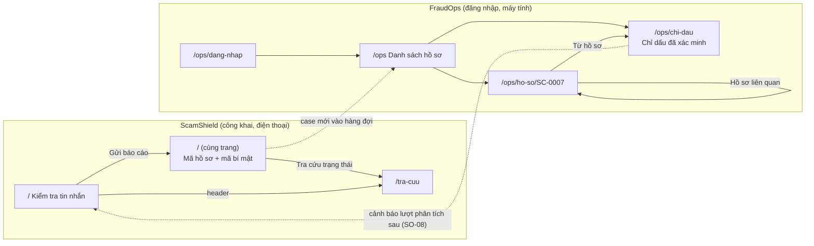

# ScamShield Ops — Phác thảo trang

**Trạng thái (20/11/2026):** BẢN NHÁP, phác thảo sơ bộ. File này cho thấy **có những trang nào và mỗi trang trông ra sao** (wireframe chữ), cùng ma trận trang ↔ dữ liệu/API.

**Phân vai giữa các file:**
- **Trạng thái và hành vi chi tiết** của từng trang (đang tải, lỗi, xung đột, …) ở [product/ui-pages.md](../product/ui-pages.md). File đó thắng file này.
- **Màu, chữ, component** ở [product/design-system.md](../product/design-system.md).
- **Endpoint** ở [architecture/api.md](../architecture/api.md).

Wireframe chỉ thể hiện **bố cục và thứ tự nội dung**, không phải thiết kế thị giác cuối cùng. Nội dung mẫu dùng thương hiệu giả "Ví XYZ" và tên miền `*.example`.

## 1. Bản đồ trang và luồng



| # | Trang | Đường dẫn | Thiết bị chính | Ưu tiên |
|---|---|---|---|---|
| 1 | Kiểm tra tin nhắn (gồm kết quả và gửi báo cáo) | `/` | Điện thoại ≥ 360px | P0 |
| 2 | Tra cứu báo cáo | `/tra-cuu` | Điện thoại | P0, cắt được (plan §7 mục 4) |
| 3 | Đăng nhập FraudOps | `/ops/dang-nhap` | Máy tính | P0 |
| 4 | Danh sách hồ sơ | `/ops` | Máy tính | P0 |
| 5 | Chi tiết hồ sơ + kết luận | `/ops/ho-so/[mã]` | Máy tính | P0 (khối hồ sơ liên quan: P1) |
| 6 | Chỉ dấu đã xác minh | `/ops/chi-dau` | Máy tính | P1, cắt đầu tiên (plan §7 mục 1) |

ScamShield không có link sang FraudOps; giám khảo vào FraudOps bằng link trong hướng dẫn 1 trang.

## 2. ScamShield `/` — Kiểm tra tin nhắn

### 2.1 Ban đầu (360px)

```
┌────────────────────────────────────┐
│ ScamShield          Tra cứu báo cáo│
├────────────────────────────────────┤
│ Tin nhắn này có đáng ngờ không?    │
│ Dán tin bạn nhận được, hệ thống    │
│ chỉ ra dấu hiệu và nên làm gì.     │
│                                    │
│ Dán tin nhắn bạn nhận được         │
│ ┌────────────────────────────────┐ │
│ │                                │ │
│ │                                │ │
│ │                                │ │
│ └────────────────────────────────┘ │
│                            0/2.000 │
│ Đừng dán mật khẩu hay mã OTP. Nếu  │
│ có, hệ thống sẽ tự che.            │
│                                    │
│ Thử tin mẫu:                       │
│ [Khoá tài khoản] [Trúng thưởng]    │
│ [Chuyển tiền gấp] [Tin OTP thật]   │
│                                    │
│ ┌────────────────────────────────┐ │
│ │           Kiểm tra             │ │
│ └────────────────────────────────┘ │
├────────────────────────────────────┤
│ Kết quả mang tính tham khảo. Hãy   │
│ xác minh qua kênh chính thức của tổ│
│ chức trước khi chuyển tiền hoặc    │
│ cung cấp thông tin.                │
└────────────────────────────────────┘
```

### 2.2 Có kết quả: Nguy cơ cao

Kết quả hiện **ngay dưới ô nhập** trên cùng trang và tự cuộn tới. Ô nhập vẫn giữ nội dung.

```
┌────────────────────────────────────┐
│ ┏━━━━━━━━━━━━━━━━━━━━━━━━━━━━━━━━┓ │
│ ┃ ▲  Nguy cơ cao                 ┃ │  ← nền đỏ nhạt, biểu tượng + chữ
│ ┃ Tin nhắn có nhiều dấu hiệu lừa ┃ │
│ ┃ đảo. Đừng bấm đường dẫn, đừng  ┃ │
│ ┃ chuyển tiền hay cung cấp OTP.  ┃ │
│ ┗━━━━━━━━━━━━━━━━━━━━━━━━━━━━━━━━┛ │
│ ⓘ Đã che mã OTP trong nội dung     │
│   trước khi phân tích.             │
│                                    │
│ Vì sao                [AI nhận định]│
│ Tin nhắc tới Ví XYZ nhưng đường    │
│ dẫn không thuộc tên miền chính     │
│ thức, đồng thời đòi mã OTP và tạo  │
│ áp lực thời gian.                  │
│                                    │
│ Dấu hiệu phát hiện                 │
│ • Tên miền không thuộc Ví XYZ      │
│                        [Kiểm tra]  │
│ • Đòi mã OTP        [AI nhận định] │
│ • Tạo áp lực thời gian             │
│                     [AI nhận định] │
│                                    │
│ Đường dẫn, số điện thoại, tài khoản│
│ ┌────────────────────────────────┐ │
│ │ vi-xac-minh.example            │ │  ← chữ thường, không bấm được
│ │ ▲ Tên miền chính thức: Cảnh báo│ │
│ │ ✓ Tên miền nhái: Không phát    │ │
│ │   hiện vấn đề                  │ │
│ │ ? Tuổi tên miền: Không tra được│ │
│ └────────────────────────────────┘ │
│                                    │
│ Nên làm gì                         │
│ 1. Không bấm vào đường dẫn.        │
│ 2. Không cung cấp mã OTP cho ai.   │
│ 3. Liên hệ Ví XYZ qua ứng dụng hoặc│
│    tổng đài chính thức.            │
│                                    │
│ ┌────────────────────────────────┐ │
│ │ Gửi báo cáo cho đội vận hành   │ │
│ └────────────────────────────────┘ │
│        Kiểm tra tin khác           │
│ (disclaimer)                       │
└────────────────────────────────────┘
```

**Bốn verdict khác nhau ở khung đầu tiên** (màu theo design-system §2):

```
┏━━━━━━━━━━━━━━━━━━━━━━━━━━━━━━━━┓   ┏━━━━━━━━━━━━━━━━━━━━━━━━━━━━━━━━┓
┃ ▲ Nguy cơ cao          (đỏ)    ┃   ┃ ! Đáng ngờ             (cam)   ┃
┗━━━━━━━━━━━━━━━━━━━━━━━━━━━━━━━━┛   ┗━━━━━━━━━━━━━━━━━━━━━━━━━━━━━━━━┛
┏━━━━━━━━━━━━━━━━━━━━━━━━━━━━━━━━┓   ┏━━━━━━━━━━━━━━━━━━━━━━━━━━━━━━━━┓
┃ i Chưa phát hiện dấu hiệu lừa  ┃   ┃ ? Chưa đủ thông tin để kết     ┃
┃   đảo                (xanh dương)┃   ┃   luận                 (xám)   ┃
┃ …không đảm bảo tin là thật.    ┃   ┃ [Thử lại] (nếu lỗi hệ thống)   ┃
┗━━━━━━━━━━━━━━━━━━━━━━━━━━━━━━━━┛   ┗━━━━━━━━━━━━━━━━━━━━━━━━━━━━━━━━┛
```

Không có phần trăm, không có thang điểm, không có chữ "an toàn".

### 2.3 Gửi báo cáo và thành công

Form mở ngay dưới kết quả, không chuyển trang.

```
┌────────────────────────────────────┐      ┌────────────────────────────────────┐
│ Gửi báo cáo cho đội vận hành       │      │ ✓ Đã gửi báo cáo                   │
│                                    │      │                                    │
│ Bạn nhận tin qua đâu? *            │      │ Mã hồ sơ                           │
│ ( ) SMS  ( ) Zalo  ( ) Messenger   │      │ ┌──────────────────┐ [Sao chép]    │
│ ( ) Email  ( ) Khác                │      │ │ SC-0007          │               │
│                                    │      │ └──────────────────┘               │
│ Ghi chú (không bắt buộc)           │  →   │ Mã bí mật                          │
│ ┌────────────────────────────────┐ │      │ ┌──────────────────┐ [Sao chép]    │
│ │                                │ │      │ │ K7QX-2M9P        │               │
│ └────────────────────────────────┘ │      │ └──────────────────┘               │
│                              0/500 │      │ ⚠ Lưu lại cả hai mã để tra cứu.    │
│ ┌────────────────────────────────┐ │      │   Mã bí mật sẽ không hiển thị lại. │
│ │          Gửi báo cáo           │ │      │                                    │
│ └────────────────────────────────┘ │      │ Tra cứu trạng thái →               │
└────────────────────────────────────┘      └────────────────────────────────────┘
```

## 3. ScamShield `/tra-cuu` — Tra cứu báo cáo

```
┌────────────────────────────────────┐      ┌────────────────────────────────────┐
│ ScamShield          Tra cứu báo cáo│      │ Hồ sơ SC-0007                      │
├────────────────────────────────────┤      │ ┌────────────────────────────────┐ │
│ Tra cứu báo cáo của bạn            │      │ │ Đã xác nhận lừa đảo            │ │
│                                    │      │ └────────────────────────────────┘ │
│ Mã hồ sơ                           │  →   │ Đội vận hành đã xem xét và xác     │
│ ┌────────────────────────────────┐ │      │ nhận tin nhắn này là lừa đảo.      │
│ │ SC-0007                        │ │      │ Cập nhật: 22/11/2026 14:05         │
│ └────────────────────────────────┘ │      │                                    │
│ Mã bí mật                          │      │ (disclaimer)                       │
│ ┌────────────────────────────────┐ │      └────────────────────────────────────┘
│ │                                │ │
│ └────────────────────────────────┘ │      Sai mã → một thông báo duy nhất:
│ ┌────────────────────────────────┐ │      "Không tìm thấy báo cáo khớp với
│ │           Tra cứu              │ │       hai mã này."
│ └────────────────────────────────┘ │
│ (disclaimer)                       │
└────────────────────────────────────┘
```

## 4. FraudOps `/ops/dang-nhap`

```
┌──────────────────────────────────────────────────────────────────────────────┐
│ FraudOps                                                                     │
├──────────────────────────────────────────────────────────────────────────────┤
│                     ┌────────────────────────────────────┐                   │
│                     │ Đăng nhập                          │                   │
│                     │                                    │                   │
│                     │ Tên đăng nhập                      │                   │
│                     │ ┌────────────────────────────────┐ │                   │
│                     │ │ judge1                         │ │                   │
│                     │ └────────────────────────────────┘ │                   │
│                     │ Mật khẩu                           │                   │
│                     │ ┌────────────────────────────────┐ │                   │
│                     │ │ ••••••••                       │ │                   │
│                     │ └────────────────────────────────┘ │                   │
│                     │ ┌────────────────────────────────┐ │                   │
│                     │ │          Đăng nhập             │ │                   │
│                     │ └────────────────────────────────┘ │                   │
│                     │ Tài khoản thử có trong hướng dẫn   │                   │
│                     │ sử dụng.                           │                   │
│                     └────────────────────────────────────┘                   │
└──────────────────────────────────────────────────────────────────────────────┘
```

## 5. FraudOps `/ops` — Danh sách hồ sơ

```
┌──────────────────────────────────────────────────────────────────────────────────────┐
│ FraudOps     Hồ sơ   Chỉ dấu đã xác minh                       judge1  [Đăng xuất]   │
├──────────────────────────────────────────────────────────────────────────────────────┤
│ Hồ sơ                                                                                │
│ Trạng thái [Chờ xem xét ▾]  Đánh giá engine [Tất cả ▾]   Tìm mã hồ sơ [SC-____ ]     │
│                                                                                      │
│ Mã hồ sơ   Thời điểm        Đánh giá engine   Loại rủi ro          Trạng thái   Liên quan│
│ ──────────────────────────────────────────────────────────────────────────────────── │
│ SC-0042    22/11 14:02      ▲ Nguy cơ cao     Mạo danh, OTP        Chờ xem xét   3   │
│ SC-0041    22/11 13:47      ! Đáng ngờ        Chuyển tiền          Chờ xem xét   —   │
│ SC-0039    22/11 11:20      ? Chưa đủ t.tin   Khác                 Chờ xem xét   —   │
│ SC-0012    21/11 09:15      ▲ Nguy cơ cao     Trúng thưởng         Chờ xem xét   1   │
│            [Dữ liệu mẫu]                                                             │
│ …                                                                                    │
│                                                    ‹ Trước   Trang 1/2   Sau ›       │
└──────────────────────────────────────────────────────────────────────────────────────┘
```

- Mặc định lọc "Chờ xem xét", mới nhất trước. Bấm cả dòng để mở hồ sơ.
- Cột "Liên quan" chỉ có khi làm SO-07.

## 6. FraudOps `/ops/ho-so/[mã]` — Chi tiết hồ sơ

### 6.1 Chờ xem xét (≥ 1024px, hai cột)

```
┌──────────────────────────────────────────────────────────────────────────────────────┐
│ FraudOps     Hồ sơ   Chỉ dấu đã xác minh                       judge1  [Đăng xuất]   │
├──────────────────────────────────────────────────────────────────────────────────────┤
│ ‹ Danh sách                                                                          │
│ SC-0042   Chờ xem xét   22/11/2026 14:02   Báo cáo từ người dùng · qua SMS           │
│                                                                                      │
│ ┌─ BẰNG CHỨNG ─────────────────────────────┐ ┌─ NHẬN ĐỊNH CỦA AI ────[AI nhận định]┐ │
│ │ Nội dung (đã che dữ liệu nhạy cảm)       │ │ Tóm tắt điều tra                    │ │
│ │ ┌──────────────────────────────────────┐ │ │ Tin nhắn mạo danh Ví XYZ, yêu cầu   │ │
│ │ │ [Ví XYZ] Tài khoản của bạn sẽ bị khoá│ │ │ người nhận truy cập một tên miền    │ │
│ │ │ trong 2 giờ. Xác minh tại            │ │ │ không thuộc Ví XYZ và nhập mã OTP.  │ │
│ │ │ vi-xac-minh.example và nhập mã OTP   │ │ │ Có 3 hồ sơ khác dùng cùng tên miền. │ │
│ │ │ [OTP ĐÃ CHE].                        │ │ │ …                                   │ │
│ │ └──────────────────────────────────────┘ │ │                                     │ │
│ │ Ghi chú người báo cáo: "Nhận lúc 9h"     │ │ Đề xuất bước tiếp theo              │ │
│ │                                          │ │ • Đối chiếu tên miền với các hồ sơ  │ │
│ │ Đánh giá của engine: ▲ Nguy cơ cao       │ │   liên quan.                        │ │
│ │ Loại rủi ro: Mạo danh, Lừa lấy OTP       │ │ • Xem xét xác nhận lừa đảo nếu bằng │ │
│ │ Quy tắc kích hoạt: tên miền sai thương   │ │   chứng nhất quán.                  │ │
│ │ hiệu + đòi OTP                           │ │   (chỉ là văn bản, không có nút)    │ │
│ │                                          │ │                                     │ │
│ │ Chỉ dấu và phép kiểm                     │ │ Dấu hiệu do AI nhận định            │ │
│ │ vi-xac-minh.example                      │ │ • Đòi mã OTP                        │ │
│ │  ▲ Tên miền chính thức: Cảnh báo         │ │ • Tạo áp lực thời gian              │ │
│ │  ? Tuổi tên miền: Không tra được         │ │                                     │ │
│ │                                          │ └─────────────────────────────────────┘ │
│ │ Dấu hiệu do kiểm tra                     │                                         │
│ │ • Tên miền không thuộc Ví XYZ            │ ┌─ HỒ SƠ LIÊN QUAN (SO-07) ───────────┐ │
│ └──────────────────────────────────────────┘ │ 3 hồ sơ khác có cùng chỉ dấu        │ │
│                                              │ SC-0012  vi-xac-minh.example  Đã đóng│ │
│ ┌─ KẾT LUẬN ───────────────────────────────┐ │ SC-0030  vi-xac-minh.example  Chờ   │ │
│ │ ( ) Xác nhận lừa đảo                     │ │ SC-0035  vi-xac-minh.example  Chờ   │ │
│ │ ( ) Không phải lừa đảo                   │ └─────────────────────────────────────┘ │
│ │ ( ) Chưa đủ bằng chứng                   │                                         │
│ │ Lý do *                                  │                                         │
│ │ ┌──────────────────────────────────────┐ │                                         │
│ │ │                                      │ │                                         │
│ │ └──────────────────────────────────────┘ │                                         │
│ │ [ Lưu kết luận và đóng hồ sơ ]           │                                         │
│ └──────────────────────────────────────────┘                                         │
└──────────────────────────────────────────────────────────────────────────────────────┘
```

- Khối **Nhận định của AI** có nền tím nhạt và badge riêng, để luôn tách khỏi **Bằng chứng** (SO-05-AC03).
- Không có nút khoá tài khoản, chặn giao dịch hay liên hệ bên thứ ba ở bất kỳ đâu (P1).

### 6.2 Đã đóng

Khối **Kết luận** được thay bằng thẻ chỉ đọc:

```
┌─ KẾT LUẬN ───────────────────────────────────────────┐
│ Xác nhận lừa đảo · judge1 · 22/11/2026 14:10         │
│ Lý do: Tên miền giả mạo, đã có 3 báo cáo cùng tên    │
│ miền.                                                │
│ ⚠ Nhân viên không đồng ý với đánh giá AI             │  ← chỉ khi khác (SO-06-AC04)
└──────────────────────────────────────────────────────┘
```

## 7. FraudOps `/ops/chi-dau` — Chỉ dấu đã xác minh (SO-08)

```
┌──────────────────────────────────────────────────────────────────────────────────────┐
│ FraudOps     Hồ sơ   Chỉ dấu đã xác minh                       judge1  [Đăng xuất]   │
├──────────────────────────────────────────────────────────────────────────────────────┤
│ Chỉ dấu đã xác minh                                                                  │
│ Các chỉ dấu này làm lượt phân tích sau có cảnh báo "đã được đội vận hành xác minh".  │
│                                                                                      │
│ Chỉ dấu                 Loại            Từ hồ sơ   Thời điểm        Người xác nhận   │
│ ──────────────────────────────────────────────────────────────────────────────────── │
│ vi-xac-minh.example     Tên miền        SC-0042    22/11 14:10      judge1  [Gỡ]     │
│ +84901234567            Số điện thoại   SC-0042    22/11 14:10      judge1  [Gỡ]     │
└──────────────────────────────────────────────────────────────────────────────────────┘

[Gỡ] → hộp thoại:
┌─ Gỡ vi-xac-minh.example khỏi danh sách? ───┐
│ Lý do *                                    │
│ ┌────────────────────────────────────────┐ │
│ │                                        │ │
│ └────────────────────────────────────────┘ │
│                     [Huỷ]  [Gỡ khỏi danh sách]│
└────────────────────────────────────────────┘
```

## 8. Ma trận trang ↔ dữ liệu và API

| Trang | Đọc dữ liệu | Ghi dữ liệu (API) | Đăng nhập |
|---|---|---|---|
| `/` | Tin mẫu (tĩnh trong mã) | `POST /api/analyses`; `POST /api/analyses/{id}/report` | Không |
| `/tra-cuu` | — | `POST /api/case-status` (chỉ đọc, dùng POST để giấu mã bí mật) | Không |
| `/ops/dang-nhap` | — | `POST /api/ops/session` | — |
| `/ops` | Server component gọi `packages/core` (`cases`): danh sách có lọc, tìm, phân trang | `DELETE /api/ops/session` (đăng xuất, ở header) | Có |
| `/ops/ho-so/[mã]` | Server component gọi `packages/core` (`cases`): `CaseDetail` (contracts §6) | `POST /api/ops/cases/{caseCode}/decision` | Có |
| `/ops/chi-dau` | Server component gọi `packages/core` (`confirmed-indicators`) | `POST /api/ops/confirmed-indicators/{id}/removal` | Có |

## 9. Việc tiếp theo cho thiết kế

- Wireframe đã đủ để viết mã giao diện. Thiết kế thị giác chi tiết (khoảng cách, bóng, trạng thái hover) làm khi viết từng màn hình bằng `/sdlc:frontend-ui-design`.
- Nội dung 3–4 tin mẫu (SO-10-AC05) soạn cùng bộ eval (research Phần B), dùng tên miền `*.example`.
