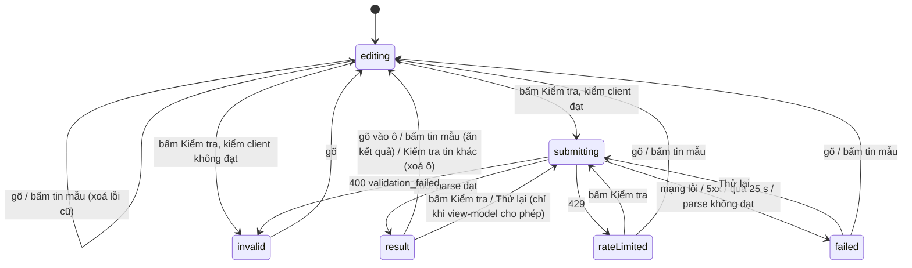

# Thiết kế slice S4: giao diện ScamShield (T-040…T-042)

**Trạng thái (27/11/2026):** **OWNER ĐÃ DUYỆT SLICE S4 ngày 26/11/2026** (`/sdlc:sign-off`), nhận mọi phương án đề xuất ở mục quyết định. Agent được viết mã cho slice này. **T-040 xong ở local 27/11** (nhánh `feat/t-040-ui-foundation`, chưa merge, chưa deploy): Tailwind v4, token, font, `Button`, `TextArea`, `CharCounter`, `Disclaimer`, `SourceBadge`, `CheckStatus`, `VerdictBanner`, `Skeleton`, `ErrorState`; chữ nhãn của chúng ở `copy/vi.ts`. `SignalList`, `IndicatorCard`, `RedactionNotice` thuộc T-042. **T-041 đã có mã 27/11** (nhánh `feat/t-041-input-states`, chưa merge, chưa deploy): trang `/`, state machine §3.1 (`features/analysis/state.ts`), `submitAnalysis` §3.2, `SampleChips`, đếm ký tự bằng `countInputChars` (shared). Vùng `aria-live` là một dòng `sr-only` luôn có trong `AnalysisFeature`, chỉ chứa nhãn verdict. Nút đang chờ khoá bằng `aria-disabled` (không dùng `disabled`) để không mất focus bàn phím. Client import `@scamshield/shared/{analysis,demo-messages,errors,input}`, không import gốc package (đã kiểm bundle: bản import gốc kéo theo tên biến môi trường server; ESLint chặn). Ngày 27/11 đã chạy route thật ở local (Postgres Docker, Groq thật) với tin M1 (`high_risk`, thiếu giải thích do Groq trả 429) và M2 (`no_signal`); chưa thử trên điện thoại. **T-042 xong ở local 27/11** (nhánh `feat/t-042-result-view`, chưa merge, chưa deploy): khối kết quả đủ theo ui-pages §2.3 (gồm hai câu khi không có tín hiệu hoặc chỉ dấu, sửa 27/11 sau khi bản đầu ẩn hai mục này), `view-model.ts` (§3.3, §5), `SignalList`, `IndicatorCard`, `RedactionNotice`. Khác bản thiết kế: fixture ở `src/features/analysis/fixtures.ts` (theo U-04 (a)), không ở `test/fixtures/`; `distance_0` chưa có câu (design-system §3). **Phải xoá `apps/web/src/app/xem-truoc/` và `test/app/preview.test.tsx` trước đóng băng 30/11** (U-04). S4 đã trễ so với lịch 24–25/11 (plan §6). Schema `AnalysisResult` (§4) và `POST /api/analyses` đã có trên `main` từ 26/11 (PR #46).

**Căn cứ và thứ bậc.** File này là thiết kế slice (cấp 5, docs/README.md). Nó **không nhắc lại** những gì đã có ở các file dưới, chỉ bổ sung phần các file đó còn để ngỏ:
- [spec](../spec/ScamShield-v1.md): SO-01-AC02, AC04; SO-03-AC03, AC04, AC06; SO-10-AC05; P2, P5.
- [ui-pages §2](../product/ui-pages.md#2-scamshield---kiểm-tra-tin-nhắn): khối nhập, bảng trạng thái, thứ tự khối kết quả.
- [design-system](../product/design-system.md): token, câu chữ chuẩn, component, a11y.
- [pages.md §2](./pages.md#2-scamshield---kiểm-tra-tin-nhắn): wireframe 360px.
- [conventions/frontend](../conventions/frontend.md): cấu trúc thư mục, ranh giới server/client, test.
- [analysis-pipeline](./analysis-pipeline.md) (owner duyệt 24/11): luật đếm ký tự §4, mã `detail` §6.5, P-01.

Nếu file này lệch với ui-pages hoặc design-system (cùng cấp 5), agent dừng và báo owner.

## 1. Kết quả cần có

Ở `/`, một người dùng trên điện thoại 360px dán tin nhắn hoặc bấm một tin mẫu, bấm **Kiểm tra** và trong khoảng 10 giây đọc được: verdict, lý do, tín hiệu kèm nguồn, chỉ dấu kèm phép kiểm, và nên làm gì. Không có trạng thái nào để người dùng chờ vô hạn hoặc mất nội dung đã dán.

**Trong slice:**
- T-040: Tailwind, token, component nền.
- T-041: khối nhập, tin mẫu, các trạng thái chờ, lỗi và giới hạn.
- T-042: khối kết quả.

**Ngoài slice:**
- form gửi báo cáo và màn có mã (T-051, S5). S4 chỉ chừa chỗ ở §2.
- `/tra-cuu` (T-052).
- nội dung tin mẫu (T-093, cả đội soạn; §7 chỉ nêu ràng buộc).
- route `POST /api/analyses` (T-039, vai C).

## 2. Module và ranh giới client

Theo frontend §1–2. Trang là server component; ranh giới `"use client"` nằm ở **một** component tính năng.

```
apps/web/src/
  app/page.tsx                       server: khung trang, tiêu đề, footer Disclaimer; render <AnalysisFeature/>
  features/analysis/
    AnalysisFeature.tsx              "use client": giữ state machine §3, gọi submitAnalysis
    InputPanel.tsx                   TextArea + CharCounter + SampleChips + nút Kiểm tra
    ResultView.tsx                   nhận AnalysisResult đã parse, không có state
    submit-analysis.ts               fetch POST /api/analyses → AnalysisOutcome (§3.2); parse bằng schema shared
    view-model.ts                    hàm thuần: AnalysisResult → dữ liệu hiển thị (nhãn, câu detail, có nút Thử lại không)
    samples.ts                       tin mẫu tĩnh (§7)
  components/                        Button, TextArea, CharCounter, SampleChips, VerdictBanner, SourceBadge,
                                     SignalList, IndicatorCard, CheckStatus, RedactionNotice, Disclaimer,
                                     Skeleton, ErrorState (design-system §4; mỗi file một component)
  copy/vi.ts                         mọi chữ hiển thị, gồm các bảng ở §5
```

- `ResultView` và các component trong `components/` không cần `"use client"` riêng. Chúng nằm dưới `AnalysisFeature` nên tự chạy ở client. Chúng chỉ nhận props, không gọi API.
- `view-model.ts` gom mọi quyết định "hiện gì" (ví dụ có hiện **Thử lại** không, câu lý do, có hiện ghi chú P-01 không). Phần này test được bằng Vitest mà không cần render.
- **Không** tạo lớp API client chung hay store toàn cục. Một màn hình chỉ có một lời gọi.
- **Chỗ cho S5:** `ResultView` nhận prop `actions` (ReactNode). S4 truyền vào nút "Kiểm tra tin khác". T-051 thêm "Gửi báo cáo cho đội vận hành" và form báo cáo, dùng `analysisId` lấy từ state. S4 **không** render nút báo cáo, để bản deploy không có nút chết (U-05).

## 3. Trạng thái phía client

### 3.1 State machine

Bảng ui-pages §2.2 là nguồn của nhãn và câu chữ. Mục này thêm chuyển trạng thái và các trường hợp bảng đó chưa nói tới.



| Trạng thái | Dữ liệu giữ | Ô nhập | Tin mẫu, nút |
|---|---|---|---|
| `editing` | `content` | Sửa được | Dùng được |
| `invalid` | `content`, `fieldError` | Sửa được, `aria-invalid` | Dùng được |
| `submitting` | `content`, `startedAt` | `readOnly` | Khoá; nút "Đang kiểm tra…", `aria-busy`. Sau 5 s thêm dòng "Vẫn đang phân tích…" |
| `result` | `content`, `result` (gồm `analysisId`) | Sửa được | Dùng được |
| `rateLimited` | `content` | Sửa được | Dùng được; câu nguyên văn SO-01-AC04 |
| `failed` | `content` | Sửa được | Nút **Thử lại** gửi lại đúng `content` |

**Quyết định trong thiết kế (agent đề xuất, nằm trong phần owner duyệt):**
- **Hết thời gian phía client: 25 giây** (`AbortController`), lớn hơn trần 20 giây của server cộng độ trễ mạng. Quá hạn thì vào `failed`, không bao giờ quay vô hạn (frontend §6).
- **Sửa ô sau khi có kết quả thì ẩn kết quả** và về `editing`. Như vậy kết quả trên màn hình luôn khớp với nội dung trong ô, và form báo cáo ở S5 không bao giờ gửi `analysisId` của một nội dung khác. Đổi lại, lỡ gõ nhầm một phím là mất kết quả; người dùng chỉ cần bấm Kiểm tra lại.
- **Mỗi lúc chỉ có một request.** Nút và tin mẫu bị khoá, ô ở chế độ `readOnly` khi đang chờ. Component unmount thì huỷ request. Vì không thể có hai request song song nên không cần đánh số request.
- **429** không tự thử lại và không đếm ngược. Hạn mức dùng chung với `/report` và `/case-status` (api.md §5), nên tự thử lại sẽ chỉ đốt hạn mức.
- **Response 200 không qua được schema** (lệch phiên bản giữa UI và server) thì xử lý như lỗi máy chủ (`failed`). UI không bao giờ render dữ liệu chưa parse.
- **Kiểm tra tin khác:** xoá ô, xoá kết quả, focus về ô nhập.
- **Sau khi gửi báo cáo thành công** (S5): thêm trạng thái `reported`. Ô nhập chỉ đọc, tin mẫu khoá, và "Kiểm tra tin khác" phải hỏi xác nhận trước khi xoá mã bí mật đang hiện. Chi tiết ở [report-flow §5.2](./report-flow.md#52-sửa-state-machine-của-s4-cần-duyệt-cùng-s4). Duyệt cùng lúc với S5.
- **Sau khi có kết quả:** cuộn tới `VerdictBanner` (tức thì nếu `prefers-reduced-motion`). Vùng `aria-live="polite"` chỉ đọc nhãn verdict. Focus **không** bị chuyển đi, để không đọc trùng hai lần.

### 3.2 Kết quả của `submitAnalysis`

```ts
type AnalysisOutcome =
  | { kind: "ok"; result: AnalysisResult }
  | { kind: "invalid"; message: string }          // 400, lấy message từ server
  | { kind: "rate_limited" }                       // 429
  | { kind: "failed" };                            // mạng, 5xx, timeout 25 s, parse không đạt
```

### 3.3 Biến thể của trạng thái `result` (view-model)

| Điều kiện | Banner | Ghi chú dưới banner | Nút **Thử lại** |
|---|---|---|---|
| `inconclusive` + `timeout` / `llm_unavailable` / `llm_invalid_output` | Chưa đủ thông tin để kết luận | Câu theo lý do (design-system §3) | **Có** |
| `inconclusive` + `insufficient_evidence` | Chưa đủ thông tin để kết luận | Câu theo lý do | Không (thử lại vẫn ra như cũ) |
| `high_risk` + `inconclusiveReason ≠ null` (P-01: bằng chứng cứng thắng khi AI lỗi) | Nguy cơ cao | "Bước phân tích bằng AI chưa chạy được; kết quả dựa trên kiểm tra của hệ thống." | **Không.** Kết luận đã là mức cao nhất; thử lại chỉ tốn hạn mức và lượt gọi LLM |
| Các trường hợp khác | Theo verdict | — | Không |

Trong mọi biến thể, chỉ dấu và phép kiểm vẫn hiện đầy đủ. `explanation = null` thì ẩn mục "Vì sao". `riskTypes` **không** hiện ở phía người dùng (ui-pages §2.3 không có mục này; trường đó phục vụ FraudOps, SO-05).

## 4. Hợp đồng và phụ thuộc (chặn T-041, T-042)

`packages/shared` hiện **chưa có** schema request hay `AnalysisResult`. UI phải đợi phần này.

| Cần | Ở đâu | Ai làm | Khi nào |
|---|---|---|---|
| `CreateAnalysisRequest` (zod, `{ content }`) và `AnalysisResult` theo contracts §5 | `packages/shared/src/analysis.ts` | **C** (team-split §3: C giữ schema; đổi schema thì báo cả nhóm) | **Tách thành PR nhỏ, làm trước T-038**, để B không phải đợi pipeline |
| Luật đếm ký tự dùng chung client/server (U-02) | `packages/shared` | A hoặc C (gắn với T-031) | Cùng PR trên |
| Tên hiển thị thương hiệu cho `detail` `brand:<id>` | `brands.json` (T-033) | A | Trước khi xong T-042; chưa có thì dùng fallback (§5.3) |

**Luật:**
- UI chỉ import schema từ `@scamshield/shared`. **Không** chép schema vào `apps/web`.
- `@scamshield/shared` có `export * from "./env"`. File đó chỉ khai báo schema, không đọc `process.env` khi import. Lúc làm T-041, kiểm bundle client không kéo theo gì của server; nếu có, thêm entry `@scamshield/shared/analysis` riêng.

**Fixture cho T-042, dùng tới khi có T-039:**
- Đặt ở `apps/web/test/fixtures/analysis-results.ts`. Mỗi fixture có một test parse bằng `AnalysisResult`, để fixture không lệch schema.
- Chỉ dùng tên miền `*.example` và thương hiệu giả "Ví XYZ".
- Phải phủ đủ: 4 verdict; từng `inconclusiveReason`; `high_risk` + lý do khác null (P-01); `signals` rỗng; `indicators` rỗng; `explanation = null`; `redactions` có và không có che; check `unavailable`; tin kiểu M2 (tên miền chính thức, `official_domain` = `pass` kèm `brand:<id>`, verdict `no_signal`); check có `detail` lạ (fallback §5.3); một tên miền rất dài, không có khoảng trắng (ngắt dòng ở 360px).
- Xem fixture trên màn hình trước khi có route thật: xem U-04.

## 5. Bảng hiển thị (owner duyệt 26/11; chuyển vào design-system §3 khi viết mã T-042)

### 5.1 `SignalType` → nhãn

Bổ sung cho design-system §3.

*(27/11, T-042: bảng nhãn đã chuyển sang [design-system §3](../product/design-system.md#3-câu-chữ-chuẩn); sửa ở đó.)*

- Không nhãn nào gọi một người là kẻ lừa đảo (P1). Nhãn mô tả tin nhắn.
- Mỗi dòng có `SourceBadge` theo `source` (*Kiểm tra* / *AI nhận định*).
- Với signal nguồn AI có `evidence`: hiện đoạn trích bên dưới, chữ phụ, đặt trong ngoặc kép, render như văn bản.
- Thứ tự: giữ đúng thứ tự server trả về. UI không tự xếp lại theo độ mạnh, vì bảng nhóm thuộc module `verdict`.

### 5.2 Chỉ dấu hiển thị

- **Hiện** `url`, `domain`, `phone`, `bank_account`, theo thứ tự server trả về.
- **Không hiện** chỉ dấu `brand` thành thẻ riêng. Tên thương hiệu xuất hiện trong câu của check `official_domain`.
- Mỗi URL có kèm một chỉ dấu `domain` (contracts §2), nên URL và tên miền của nó hiện thành hai thẻ. Chấp nhận trùng lặp này trong v1; gộp hai thẻ cần thêm trường liên kết trong hợp đồng. Thẻ không có check nào thì chỉ hiện giá trị.
- Mọi giá trị là văn bản thuần, font đơn cách, `overflow-wrap: anywhere`, không `href` (P5, frontend §5).

### 5.3 Mã `detail` → câu

Câu phụ thuộc **cả loại phép kiểm, trạng thái và mã**, không chỉ mã. Ví dụ: check `official_domain` có mặt mỗi khi tìm thấy thương hiệu (pipeline §6.5) và ra `pass` khi tên miền đúng là chính thức. Nếu chỉ dịch theo mã `brand:<id>` thì tin OTP thật M2 sẽ bị ghi "không thuộc tên miền chính thức". Trong mã (`checkDomain`, kiểm 27/11): `official_domain` + `pass` có mang `brand:<id>`; `lookalike`, `punycode`, `subdomain_brand` khi `pass` không có `detail`.

*(27/11, T-042: bảng câu đã chuyển sang [design-system §3](../product/design-system.md#3-câu-chữ-chuẩn); sửa ở đó. Luật áp bảng ở dưới.)*

- **Tổ hợp không có trong bảng** (ví dụ `lookalike` + `pass` mà vẫn có mã) thì không hiện detail; trạng thái (*Không phát hiện vấn đề*) đã đủ nghĩa.
- **Fallback:** mã lạ, sai định dạng, hoặc `brand:<id>` không có trong `brands.json` thì **chỉ hiện tên phép kiểm và trạng thái, không hiện detail**. Không bao giờ in mã thô ra màn hình.
- Phần giá trị trong mã (tên miền, dạng Unicode) có thể do kẻ gian đặt ra, nên luôn render như văn bản.
- **Lệch tài liệu (U-03):** contracts §4 (cấp 3) lấy ví dụ `distance_1:<tên miền chính thức>`, còn pipeline §6.5 (cấp 5, owner đã duyệt) ghi `nearest:<tên miền>:distance_1`. Owner chốt U-03 (a) ngày 26/11: theo pipeline; ví dụ ở contracts §4 đã sửa.

## 6. Nền giao diện (T-040)

- **Tailwind:** cách nối token CSS (design-system §2) vào theme phụ thuộc phiên bản. Lúc làm T-040, đọc tài liệu của **đúng phiên bản ghim** và hướng dẫn Next.js trong `node_modules/next/dist/docs/` (apps/web/AGENTS.md cảnh báo bản Next này khác kiến thức cũ). Không viết cú pháp theo trí nhớ. Ghi phiên bản vào libraries.md.
- Thay CSS tay hiện có trong `globals.css` bằng token và Tailwind. Giữ `lang="vi"` và `color-scheme: light`.
- **Font:** Be Vietnam Pro qua `next/font` (U-01). Nếu chọn, ghi vào bảng tài sản có sẵn ở README.
- **Biểu tượng:** SVG inline tự vẽ (design-system §4), không thêm thư viện.

## 7. Tin mẫu (SO-10-AC05)

- *(S9 đề xuất đổi: đọc từ `packages/shared/data/demo-messages.json`, xem [demo-data §2](./demo-data.md#2-tin-demo-một-nguồn-duy-nhất-t-093).)* 3–4 tin tĩnh trong `features/analysis/samples.ts`, chữ nằm ở đó hoặc ở `copy/vi.ts`. Bấm chip thì **điền** vào ô, không tự gửi. Đang có kết quả thì bấm chip cũng ẩn kết quả (§3.1).
- Chỉ dùng tên miền `*.example` và thương hiệu giả. Một tin là tin OTP thật (M2), phải ra `no_signal` (team-split §3; A kiểm verdict).
- Nội dung do T-093 soạn. Trước khi có T-093, dùng tạm 4 tin trong fixture §4.

## 8. Kiểm thử

Theo frontend §8 (C-01: Vitest cho logic thuần, Playwright cho E2E, không dùng Testing Library).

| Tầng | Kiểm gì |
|---|---|
| Unit `view-model` | Mọi dòng bảng §3.3; mỗi `SignalType` đều có nhãn (lặp qua enum); mọi dòng (phép kiểm × trạng thái × mã) ở §5.3, kể cả `official_domain` + `pass`, tổ hợp ngoài bảng và fallback; `explanation = null` thì ẩn mục |
| Unit đếm ký tự | Dùng chung hàm với server (U-02). Ca thử: tiếng Việt dạng tổ hợp, emoji, ký tự độ rộng 0, đúng 2.000 và 2.001 ký tự |
| Unit `submitAnalysis` | `fetch` giả: 200 đạt schema; 200 sai schema → `failed`; 400; 429; 500; mạng lỗi; quá 25 s |
| So chuỗi | Disclaimer, câu 429, nhãn 4 verdict, câu `verified_indicator`, so với design-system §3 |
| Bất biến render (U-06) | `renderToStaticMarkup(<ResultView/>)` trên **mọi fixture**: không có "an toàn", không có `%`, không có `<a`/`href`, không có `dangerouslySetInnerHTML` |
| Kiểm tay có bằng chứng | Ảnh chụp 360px và 1280px cho 4 verdict, trạng thái chờ, 429, lỗi mạng; thao tác hết bằng bàn phím; ghi trong báo cáo `/sdlc:verify` |
| E2E | Thuộc T-092 (C) |

- `apps/web/test/app/page.test.tsx` hiện kiểm "trang không có `textarea`/`input`/`a`". S4 sẽ làm test này hỏng. **Thay** bằng: trang có `textarea` có nhãn; vẫn có disclaimer; không có "an toàn"; không có `<a href>` nào chứa giá trị người dùng. Link nội bộ cố định như "Tra cứu báo cáo" thì được phép khi T-052 xong.
- Luật ESLint `react/no-danger` đã bật ở `eslint.config` (frontend §5); không tắt cho thư mục `features/`.

## 9. Ánh xạ AC → kiểm

| AC | Kiểm bằng |
|---|---|
| SO-01-AC02 | Unit đếm ký tự và kiểm client; unit `submitAnalysis` với 400; kiểm tay lỗi hiện dưới ô, có `aria-describedby` |
| SO-01-AC04 | So chuỗi câu 429; unit `submitAnalysis` với 429; kiểm tay ô vẫn giữ nội dung |
| SO-03-AC03 | Unit view-model cho `no_signal` (câu nhắc tự kiểm tra) và `insufficient_evidence`; bất biến không có "an toàn" |
| SO-03-AC04 | Bất biến không có `%`; unit nhãn và badge nguồn cho mọi `SignalType`; ảnh chụp 360px |
| SO-03-AC06 | Unit view-model cho `timeout` (có Thử lại); unit timeout client 25 s |
| SO-05-AC03 | Phía ScamShield: mục "Vì sao" có nhãn *AI nhận định*, khuyến nghị không có nhãn đó, tách khỏi phép kiểm (kiểm tay). Phần chính của AC này nằm ở FraudOps (T-062) |
| SO-10-AC05 | Kiểm tay: bấm chip thì điền vào ô, không gửi; E2E T-092 |
| P5 | Bất biến không có `href`; kiểm tay URL dài ngắt dòng, không bấm được |

## 10. Quyết định (owner chốt 26/11/2026)

Tiền tố `U-` (giao diện slice S4), chưa dùng ở tài liệu nào khác.

| ID | Câu hỏi | Phương án và đánh đổi | Đề xuất |
|---|---|---|---|
| U-01 | Font | (a) Be Vietnam Pro qua `next/font`: dấu tiếng Việt đẹp, tự host lúc build, thêm một tài sản vào README. (b) `system-ui`: không cần thêm gì, dấu hiển thị khác nhau giữa các máy | (a) · **Owner chốt 26/11** |
| U-02 | Luật đếm 2.000 ký tự ở client | (a) **Chuyển `normalizeInput` (hàm thuần) sang `packages/shared`**, client và server gọi cùng một hàm. Bộ đếm khớp tuyệt đối với server, nhưng phải đổi chỗ một hàm trong pipeline §11 (đã duyệt; chỉ đổi vị trí, không đổi hành vi). (b) Client tự đếm code point sau NFC và trim: không đụng S3, nhưng lệch khi tin có ký tự độ rộng 0. (c) Dùng `maxLength` của textarea: **sai**, vì nó đếm theo UTF-16 | (a) · **Owner chốt 26/11** |
| U-03 | Định dạng mã `detail` của `lookalike` (§5.3) | (a) Theo pipeline §6.5 `nearest:<tên miền>:distance_<n>`; sửa ví dụ ở contracts §4. (b) Theo contracts §4 `distance_<n>:<tên miền>`; sửa pipeline §6.5 | (a): chi tiết hơn và đã được duyệt cùng phép kiểm · **Owner chốt 26/11** |
| U-04 | Xem fixture trên màn hình trước khi có T-039 | (a) Trang dev `/xem-truoc` render `ResultView` cho mọi fixture, trả `notFound()` khi `NODE_ENV = production`. Có sẵn chỗ để chụp ảnh làm bằng chứng, nhưng thêm một route và đưa fixture vào `src/`. (b) B tạm sửa route ở máy mình, không commit: không thêm gì vào repo, nhưng không ai khác xem lại được. (c) Chỉ dùng test bất biến, chờ T-039 mới xem: rẻ nhất, nhưng dồn rủi ro giao diện về 27–28/11 | (a), xoá trước khi đóng băng 30/11 · **Owner chốt 26/11** |
| U-05 | Nút "Gửi báo cáo" trước khi có S5 | (a) Không render cho tới T-051. (b) Render nhưng khoá | (a): tránh nút chết trên bản deploy · **Owner chốt 26/11** |
| U-06 | Test bất biến bằng `renderToStaticMarkup` | frontend §8 cấm test render component, nhưng `page.test.tsx` đã dùng cách này. (a) Cho phép **chỉ** cho test bất biến (chuỗi cấm, không có `href`), không test tương tác; ghi thêm vào frontend §8. (b) Bỏ, chỉ kiểm tay | (a) · **Owner chốt 26/11** |

## 11. Rủi ro

- **Phụ thuộc S3 (đã gỡ 26/11):** schema ở §4 đã có trên `main` (PR #46), nên T-041 và T-042 typecheck được.
- **Lịch:** plan §6 đặt giao diện ScamShield ở 24–25/11; hôm nay là 26/11. Nếu cần cắt, plan §7 giữ nguyên "tách *Kiểm tra* / *AI nhận định*" và disclaimer. Phần nên hoãn là độ trau chuốt, không phải trạng thái lỗi.
- **Tailwind và Next 16:** cú pháp tích hợp có thể khác kiến thức cũ. Đã ghi ở §6, phải kiểm theo tài liệu của phiên bản ghim.
