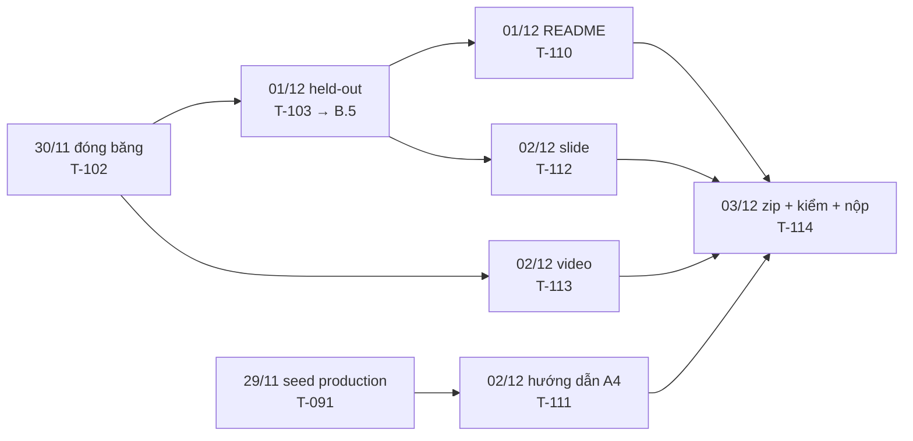

# Thiết kế slice S11: nộp bài vòng loại (T-110…T-114)

**Trạng thái (26/11/2026):** **OWNER ĐÃ DUYỆT SLICE S11 ngày 26/11/2026** (`/sdlc:sign-off`), nhận mọi phương án đề xuất ở mục quyết định. Agent được viết mã cho slice này. Slice này gần như không có mã ứng dụng. Phần duy nhất là một script đóng gói và kiểm secret (§6), nằm ngoài `apps/` và `packages/`. Hạn nộp: **trước 03/12/2026**. Slide **không sửa được sau khi nộp**.

**Căn cứ:**
- [plan §1, §9](../runbook/plan.md): bốn thành phần phải nộp và checklist.
- [demo.md](../runbook/demo.md): kịch bản video, checklist quay, giai đoạn chấm 03–11/12.
- [spec SO-09-AC04, SO-10-AC01, AC02](../spec/ScamShield-v1.md), spec §9 (disclaimer, không dùng logo).
- [research/result.md B.5](../research/result.md): số liệu duy nhất được đưa lên slide.
- [project-proposal](../research/project-proposal.md): vấn đề, bằng chứng, giới hạn đã viết.
- [eval-suite §4](./eval-suite.md) (S10): đóng băng 30/11, held-out 01/12.

## 1. Kết quả cần có

Trước 03/12, nộp đủ bốn thứ:
1. Hướng dẫn sử dụng 1 trang A4 (PDF)
2. Mã nguồn `.zip` kèm README
3. Slide tối đa 10 trang (PDF)
4. Video tối đa 3 phút (MP4)

Mọi số liệu và mọi cảnh trong bài nộp đều lấy từ sản phẩm chạy thật và từ lần chạy held-out. Link sản phẩm còn sống tới hết 11/12.

## 2. Đường găng

- Slide và README đều cần số B.5. Nếu held-out trễ thì cả hai trễ theo, nên phải soạn **khung slide từ 29/11**, chừa ô số liệu (§4).
- Video chỉ cần bản deploy đã đóng băng, không cần số held-out. Đoạn 2:40–3:00 có số liệu thì chèn sau bằng một khung tĩnh lấy từ B.5.
- **Mục tiêu nộp: 02/12 tối,** chừa 03/12 làm ngày dự phòng.

## 3. README (T-110)

README hiện đã có các mục: hệ thống chạy thế nào, cấu trúc repo, quy trình, cách chạy, công nghệ / tài sản / công cụ AI. Phần cần bổ sung hoặc cập nhật:

| Mục | Nội dung | Nguồn |
|---|---|---|
| Link sản phẩm | URL production; ghi rõ tài khoản thử nằm trong hướng dẫn A4, không nằm trong README | T-091 |
| Cách chạy | Đối chiếu với `setup-and-bringup.md`; thêm `demo:seed`, `demo:reset`, `npm run eval`, `npm run e2e`. Chỉ trỏ tới `.env.example`, không ghi giá trị thật | demo-data §7, eval-suite §3 |
| Thư viện mã nguồn mở | Lấy **đúng** từ `docs/conventions/libraries.md` và `package.json`: thêm Next.js, Tailwind, `tldts`, Playwright nếu đã cài. Không liệt kê thư viện chưa cài | libraries.md |
| Tài sản có sẵn | Font Be Vietnam Pro và giấy phép của nó (nếu U-01 chọn); biểu tượng là SVG tự vẽ; không dùng logo hay màu nhận diện của tổ chức nào | scamshield-ui U-01, spec §9 |
| Công cụ AI | Hai loại, tách rõ: (1) **trong sản phẩm**: Groq, model chính và dự phòng (Q-08); (2) **khi phát triển**: Claude Code + my-sdlc-kit | Q-08, README hiện tại |
| Số eval | Bảng rút gọn từ B.5, có mẫu số, kèm câu giới hạn nguyên văn từ SO-09-AC04; trỏ tới file `eval/results/…` | B.5 |
| Giới hạn và phạm vi | Bảng "Ngoài v1" (spec §4); tính năng P1 đã cắt (nếu có); không có tính năng tự khoá hay chặn (P1) | spec §4, plan §7 |

**Luật:** README không có con số nào không có trong B.5 hoặc research A.6. Không ghi số tiết kiệm thời gian của nhân viên, vì chưa đo (proposal §3).

## 4. Slide ≤ 10 trang (T-112)

Khung đề xuất. Mỗi trang ghi nguồn trong ghi chú người trình bày.

| # | Trang | Nội dung chính | Nguồn |
|---|---|---|---|
| 1 | Tiêu đề | Tên sản phẩm, một câu "AI đề xuất, con người quyết định" | pitch.md |
| 2 | Vấn đề | Người dùng có vài phút để đoán; đội vận hành nhận báo cáo rời rạc | proposal, bằng chứng E1–E3 |
| 3 | Đối tượng | Người dùng ví/ngân hàng; nhân viên vận hành fintech | spec §2 |
| 4 | Giải pháp | Hai giao diện, một engine; 6 bước của plan §1 | system-design §11 |
| 5 | Vì sao tin được | P1–P5: verdict bằng quy tắc, mỗi signal ghi nguồn, không mở URL, không tự khoá | spec §1 |
| 6 | ScamShield | Ảnh chụp 360px: M1 *Nguy cơ cao*, M2 *Chưa phát hiện dấu hiệu lừa đảo* | Bản deploy đóng băng |
| 7 | FraudOps | Ảnh chụp 1280px: Bằng chứng / Nhận định của AI, kết luận | Bản deploy đóng băng |
| 8 | Vòng phản hồi | Hồ sơ liên quan và chỉ dấu đã xác minh. **Bỏ trang này nếu cắt S7 và S8**, dồn chỗ cho trang 9 | S7, S8 |
| 9 | Số liệu | Bảng B.5 có mẫu số; câu giới hạn SO-09-AC04 **trên cùng trang** | B.5 |
| 10 | Kiến trúc và lộ trình | Sơ đồ ngắn, công nghệ; mục "Ngoài v1" làm lộ trình | system-design, spec §4 |

**Luật cho slide:**
- Không logo, màu nhận diện hay ảnh chụp giao diện của MoMo hoặc tổ chức khác (AGENTS.md). Tên thương hiệu thật chỉ xuất hiện trong nội dung tin nhắn mẫu.
- Ảnh chụp lấy từ bản deploy đóng băng. Không ảnh nào lộ email, URL dashboard hay key.
- Mọi con số có nguồn ở B.5 hoặc A.6. Số của S2 (Q-08) **không** được ghi như KPI của toàn pipeline (protocol §5).
- Không chữ "an toàn" làm verdict, không phần trăm xác suất cho từng tin.
- **Kiểm chéo trước khi xuất PDF:** một người không làm slide đọc lại, đối chiếu từng số với B.5, kiểm chính tả, kiểm đủ 10 trang trở xuống, kiểm phông đã nhúng vào PDF. Ghi tên người kiểm vào ghi chú T-112.
- File nguồn của slide để ngoài repo (công cụ tuỳ đội chọn). Chỉ bản PDF đi vào bài nộp. Có thể đặt bản sao ở `docs/submission/` nếu owner muốn (NB-03).

## 5. Hướng dẫn 1 trang A4 (T-111) và video (T-113)

**Hướng dẫn A4** (demo.md §5):
- Link ScamShield, link FraudOps.
- `judge1…judge5` kèm mật khẩu.
- Bốn bước dùng thử theo plan §1.
- Một tin để thử: M1, kèm chỉ dẫn "bấm tin mẫu *Khoá tài khoản*".
- Mã `SC-0001` cùng mã bí mật để thử `/tra-cuu`, nếu có T-052 và DM-01.
- Disclaimer nguyên văn spec §9.

**Mật khẩu chỉ có trong file PDF nộp bài.** File nguồn và file PDF **không** nằm trong repo hay trong zip (§6 sẽ chặn). Soạn ở máy owner, lấy mật khẩu từ `.env`. Trước khi xuất PDF, đăng nhập thử bằng cả 5 tài khoản trên production.

**Video:**
- Theo demo.md §1 và checklist §3.
- Nếu cắt S7 hoặc S8, theo dòng "Nếu cắt SO-07/SO-08" của demo.md.
- Trước khi quay: chạy `demo:reset` và kiểm `/ops/chi-dau` (verified-indicators §7).
- Nhạc nền, nếu có, phải có giấy phép, và ghi vào bảng tài sản trong README.
- Xuất MP4, kiểm độ dài ≤ 3:00 bằng trình phát, không tin vào thời lượng do phần mềm dựng báo.

## 6. Đóng gói mã nguồn và kiểm secret (T-114)

**Vấn đề:**
- Nén thư mục làm việc thì kéo theo `.env`, `node_modules`, `.next`, cache eval.
- `git archive` thì **không** kèm nội dung submodule `tools/sdlc-kit` (plan §9).

**Script đề xuất:** `scripts/package-submission.sh`, owner chạy:
1. Dừng nếu cây làm việc còn thay đổi chưa commit, hoặc `HEAD` khác commit đóng băng (eval-suite §4.1) cộng các commit sửa tài liệu sau đó.
2. `git ls-files --recurse-submodules` → danh sách file đã theo dõi, gồm cả file trong submodule. File bị gitignore (`.env`, `node_modules`, `eval/.cache`) tự nhiên không có trong danh sách.
3. Nén danh sách đó thành `scamshield-ops-<commit7>.zip` ở **ngoài** repo.
4. **Kiểm sau khi nén,** trên chính file zip. Dừng và in **tên file** (không in nội dung) nếu thấy:
   - tên file `.env` hoặc `.env.*` (trừ `.env.example`), `*.pem`, `*.key`;
   - chuỗi khớp dạng khoá API Groq, hay khoá API Google;
   - chuỗi `postgres://…:…@` có mật khẩu, trừ giá trị giả trong `.env.example` và docker-compose local;
   - mật khẩu tài khoản thử. Script đọc `DEMO_STAFF_PASSWORDS` từ `.env` và tìm từng giá trị trong zip, **không in ra màn hình**.
5. In kích thước zip, số file, và commit.

- Script không gọi dịch vụ ngoài, không tải gì.
- Owner giải nén zip vào một thư mục trống và chạy `npm ci && npm run verify`. Đây là bằng chứng zip tự chạy được, ghi vào ghi chú T-114.
- `eval/results/` **có** trong zip (SO-09-AC04). Các file này chứa đầu ra của model trên câu tự soạn, không có secret. Bước 4 vẫn quét chúng.

## 7. Ngày nộp và giai đoạn chấm

**Ngày nộp (T-114):**
- [ ] Mở link ở chế độ ẩn danh trên máy tính và trên điện thoại thật (SO-10-AC01); chạy M1; đăng nhập `judge1`.
- [ ] `/api/health` trả 200.
- [ ] Bốn file đúng định dạng và giới hạn (A4 một trang, slide ≤ 10 trang, video ≤ 3:00, zip đã qua §6).
- [ ] Commit đóng băng, commit của zip và bản đang chạy trên production khớp nhau, hoặc khác nhau chỉ ở commit tài liệu. Ghi cả ba vào ghi chú T-114.

**Giữ link sống tới 11/12:**
- **D-04 (Supabase gói Free tạm dừng project khi không hoạt động)** vẫn đang mở. Khoảng 03/12–11/12 dài 8 ngày. Lần kiểm hằng ngày ở demo.md §5 (mở trang, chạy M1, gọi `/api/health`) cũng giữ cho DB hoạt động.
- Owner **phải** kiểm chính sách tạm dừng hiện hành của Supabase trước 03/12, đúng như hạn D-04 đã ghi.
- Từ 03/12 không deploy tính năng mới (demo.md §4).

## 8. Quyết định (owner chốt 26/11/2026)

Tiền tố `NB-` (nộp bài, slice S11), chưa dùng ở tài liệu nào khác.

| ID | Câu hỏi | Phương án và đánh đổi | Đề xuất |
|---|---|---|---|
| NB-01 | Held-out chưa chạy kịp khi phải chốt slide | (a) Dùng số **tập dev**, ghi rõ "tập dev, đã dùng để chỉnh", trên cùng trang với câu giới hạn. (b) Bỏ trang số liệu: thiếu bằng chứng mà plan §1 yêu cầu | (a); không bao giờ gọi số dev là held-out · **Owner chốt 26/11** |
| NB-02 | Thêm `scripts/package-submission.sh` vào repo | Script ngoài `apps/`, `packages/`, không đổi hành vi sản phẩm. Có trong repo thì đội khác kiểm lại được cách đóng gói; người đọc zip cũng thấy cách bài được đóng gói | Thêm; cập nhật codebase.md §3 · **Owner chốt 26/11** |
| NB-03 | Lưu bản PDF slide và bản PDF A4 trong repo | Slide: có thể (`docs/submission/`), giúp truy vết. A4: **không**, vì có mật khẩu | Slide: tuỳ owner. A4: không · **Owner chốt 26/11** |
| NB-04 | Ai kiểm chéo slide | Một người không làm slide (A hoặc C), trước 02/12 trưa | **Vai A**, owner chốt 26/11 |

## 9. Rủi ro

- **Slide không sửa được:** sai một số hay một chữ là giữ nguyên tới chung kết. Kiểm chéo (§4) là bắt buộc, không phải tuỳ chọn.
- **Lộ secret qua zip hoặc ảnh chụp:** §6 kiểm zip. Ảnh chụp và video thì chỉ kiểm bằng mắt theo checklist demo.md §3.
- **Chuỗi phụ thuộc dài:** S3 → eval → held-out → slide. Một ngày trễ ở S3 lan tới slide. Khung slide và README soạn trước, độc lập với số liệu (§2).
