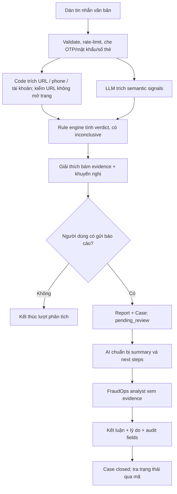

# ScamShield Ops — Đề xuất sản phẩm và tổng hợp nghiên cứu

**Phiên bản:** Proposal v1.1 · **Ngày tổng hợp:** 24/11/2026 · **Trạng thái:** Đề xuất để review, không thay thế đặc tả đã chốt  
**Bối cảnh:** MoMo Tech Talent 2026 — *Imagine the Future Workspace (Human Centered. AI Powered)*  
**Chủ đề đăng ký:** **Chống lừa đảo** (trọng tâm) và **Trợ lý AI** (kết hợp); có kỹ thuật liên quan đến an ninh mạng.  
**Phạm vi trình bày:** MVP ScamShield Ops trong cuộc thi, không phải một sản phẩm fintech đã sẵn sàng vận hành thương mại.

> **Đề xuất cốt lõi:** Chuyển tin nhắn đáng ngờ và báo cáo của người dùng thành hồ sơ điều tra có bằng chứng, trong đó AI hỗ trợ nhận diện, tổng hợp và giải thích; con người là người xác minh và đưa ra quyết định cuối cùng.

**Quy ước về bằng chứng:** [I1]–[I8] là tài liệu **nội bộ dự án** (quyết định/thiết kế/số đo tại thời điểm kiểm tra); [E1]–[E12] là **nguồn công khai** (báo cáo, tài liệu chính thức của sản phẩm hoặc nhà cung cấp). Các nhận xét về nhu cầu, khả năng giảm thời gian xử lý và khác biệt cạnh tranh được ghi rõ là **giả thuyết/định vị đề xuất**, không được coi là kết quả khảo sát hay benchmark. Những thiết kế chưa triển khai không được mô tả như chức năng đã hoạt động.

## 1. Giới thiệu chủ đề và định vị sản phẩm

### 1.1. Vấn đề cuộc thi và phạm vi lựa chọn

Đề bài yêu cầu hình dung AI có thể thay đổi công việc của đội ngũ fintech và qua đó cải thiện cách con người tương tác với dịch vụ số. Các chủ đề được phép gồm Trợ lý AI, An ninh mạng và Chống lừa đảo; một sản phẩm có thể thuộc nhiều chủ đề. ScamShield Ops lựa chọn **hai chủ đề liên kết qua một quy trình nghiệp vụ**, không phát triển hai ứng dụng độc lập: (1) giúp người dùng cảnh giác trước hành vi lừa đảo qua tin nhắn; (2) hỗ trợ nhân viên fintech xử lý báo cáo bằng AI trong workspace [I1, I2].

Định vị **workspace-first** nghĩa là FraudOps là phần chứng minh AI đổi cách nhân viên làm việc, trong khi ScamShield là kênh tương tác và tiếp nhận thông tin từ người dùng. Đây là một **AI-assisted fraud investigation workflow**, chưa phải autonomous agent hay nền tảng điều tra đa tác nhân [I1, I3].

### 1.2. Một sản phẩm, hai giao diện, một engine

| Cấu phần | Đối tượng | Giá trị trực tiếp | Giới hạn |
|---|---|---|---|
| **ScamShield** | Cá nhân nhận tin nhắn đáng ngờ | Dán văn bản, nhận đánh giá rủi ro kèm dấu hiệu, nguồn bằng chứng, khuyến nghị; tùy chọn gửi báo cáo | Không xác nhận một tin nhắn “an toàn”; không tự bấm/mở link |
| **AI Risk Engine** | Hai giao diện sử dụng chung | Trích chỉ dấu bằng code; kiểm tra URL dưới dạng chuỗi/metadata; LLM trích tín hiệu ngữ nghĩa và viết giải thích; rule engine tính verdict | Không giao LLM quyền tự kết luận gian lận, chặn giao dịch hoặc khóa tài khoản |
| **FraudOps** | Nhân viên vận hành fintech | Nhận report thành case có dữ liệu gốc đã che, chỉ dấu, kết quả kiểm, tóm tắt AI; xem và ghi nhận kết luận | Chưa có assignment, SLA, nhiều cấp duyệt hay tích hợp hệ thống thanh toán thật |

**Thông điệp sản phẩm:** *AI chuẩn bị hồ sơ có bằng chứng; nhân viên chịu trách nhiệm kết luận; người dùng được hỗ trợ phòng ngừa trước khi hành động.* Điều này cụ thể hóa **Human Centered** (quyền quyết định thuộc người) và **AI Powered** (AI giảm công đọc, phân loại, tổng hợp thông tin) [I1, I2].

### 1.3. Nguyên tắc vận hành

Năm nguyên tắc P1–P5 của [spec §1](../spec/ScamShield-v1.md) chi phối mọi thiết kế: **con người quyết định** (không tự khoá ví, chặn giao dịch hay kết luận ai là kẻ gian), **mọi tín hiệu có nguồn** (kiểm tra bằng code hay AI nhận định), **không chắc thì nói không chắc** (`inconclusive`, không bao giờ nói "an toàn"), **mức rủi ro do quy tắc trong code**, và **không mở URL người dùng gửi** [I1, I4].

## 2. Pain points, bằng chứng và giả thuyết cần kiểm chứng

### 2.1. Bối cảnh rủi ro lừa đảo trực tuyến

Theo thông tin Bộ Công an được VOV dẫn ngày 30/12/2025, từ năm 2020 đến thời điểm báo cáo, Việt Nam ghi nhận **hơn 24.000 vụ lừa đảo trực tuyến với thiệt hại gần 40 nghìn tỷ đồng** [E1]. Đây là **số liệu toàn cảnh**, không phải số vụ liên quan trực tiếp đến ví điện tử hay khối lượng báo cáo gửi vào một đội FraudOps.

Khảo sát trực tuyến của Hiệp hội An ninh mạng quốc gia (NCA) trên hơn **60.300 người trả lời** trong tháng 12/2025 cho thấy, trong số những người cho biết đã bị lừa, **32,12% trình báo cơ quan chức năng** và **12,03% chấp nhận thiệt hại mà không hành động** [E2]. Số liệu dựa vào mẫu tự nguyện và hành vi khai báo; **không được suy rộng trực tiếp thành tỷ lệ của toàn bộ dân số** hoặc tỷ lệ gửi báo cáo vào fintech.

Cổng thông tin Chính phủ cũng ghi nhận các thủ đoạn liên quan đến mạo danh, tin nhắn trúng thưởng và lời mời đầu tư đáng ngờ, cho thấy nhu cầu cảnh báo không giới hạn ở một mẫu URL độc hại [E3].

**Liên hệ trực tiếp với hệ sinh thái fintech:** ngày **13/11/2026**, Bộ Công an đưa tin NCA, Google, Liên minh Niềm tin số và **MoMo** cùng tổ chức tọa đàm về **mạng lưới chia sẻ tín hiệu rủi ro** (URL, số tài khoản, số điện thoại) để cải thiện phòng chống lừa đảo [E12]. Sự kiện chứng minh vấn đề liên kết những tín hiệu rời rạc đang được thảo luận công khai, **không** có nghĩa ScamShield Ops tham gia mạng lưới, có quan hệ với MoMo hay đã triển khai chia sẻ liên tổ chức. Những nguồn này hỗ trợ tính cấp thiết của **bài toán chống lừa đảo**, nhưng **không chứng minh** rằng mọi đội vận hành fintech hiện đều có cùng quy trình hay cùng mức độ tốn công.

### 2.2. Hai nhóm pain point liên kết với nhau

| Đối tượng | Tình huống hiện tại | Pain point | Hệ quả cần nghiên cứu | Phản hồi của MVP |
|---|---|---|---|---|
| **Người dùng** | Nhận SMS/Zalo/tin nhắn đòi xác minh tài khoản, cung cấp OTP hoặc chuyển tiền | Khó phân biệt ngôn ngữ mạo danh với thông báo hợp lệ; dễ hành động trong áp lực thời gian | Nguy cơ mất tiền/dữ liệu; bối rối khi không có kênh kiểm chứng rõ ràng | Phân tích văn bản tiếng Việt, hiển thị dấu hiệu, giới hạn kết luận và khuyến nghị tự xác minh |
| **Người dùng muốn báo cáo** | Có tin nhắn hoặc chỉ dấu đáng ngờ nhưng không biết gửi thế nào | Báo cáo tách rời bước kiểm tra; khó theo dõi | Thiếu một đường đi liền mạch từ kiểm tra đến ghi nhận | Gửi báo cáo sau analysis; nhận mã case và mã bí mật để tra trạng thái |
| **Fraud Analyst** | Nhận nội dung nhiều dạng, phải đọc và phân tích lại | Khó thống nhất cấu trúc bằng chứng; cần phân biệt nhận định AI với kiểm tra khách quan | Thời gian xử lý và chất lượng kết luận có thể biến thiên | Case chuẩn hóa, chỉ dấu và phép kiểm có nguồn, tóm tắt AI; analyst kết luận |
| **Đội vận hành fintech** | Cần lưu lịch sử kết luận và có khả năng nhận biết các báo cáo liên quan | Dữ liệu phân tán làm việc tổng hợp khó hơn | Khó theo dõi quyết định và tái sử dụng thông tin đã xác minh | Case/decision lưu bền; liên kết chỉ dấu và feedback là **P1**, chỉ làm nếu kịp |

**Trạng thái bằng chứng:** pain point của người dùng có dữ liệu bối cảnh công khai [E1–E3]. Pain point về **thời gian xử lý báo cáo của nhân viên** hiện là **giả thuyết nghiệp vụ dựa trên mô hình sản phẩm** [I1, I2], **chưa có phỏng vấn analyst hoặc baseline thời gian thao tác thực tế**. Không gắn các con số tiết kiệm thời gian chưa đo vào slide.

### 2.3. Câu hỏi nghiên cứu/giả thuyết kiểm định

1. Với tin nhắn tiếng Việt ngắn, kết hợp parser URL + signal ngữ nghĩa có nhận diện được tín hiệu đáng ngờ đồng thời giảm dương tính giả trên tin hợp lệ không?
2. Khi bằng chứng thiếu hoặc phép tra cứu lỗi, cách hiển thị **inconclusive** có tránh cảm giác chắc chắn giả tạo không?
3. Với cùng một báo cáo, analyst có truy cập đủ bằng chứng và ghi quyết định nhanh, nhất quán hơn so với quy trình đọc tin nhắn không cấu trúc không? **Cần benchmark mô phỏng**, chưa thể khẳng định.
4. Liệu luồng **analyze → report → case → human decision** có chạy ổn định từ đầu đến cuối và vẫn giữ được dữ liệu sau reload hay không?

## 3. Nguồn tài nguyên sẵn có và khả năng sử dụng

### 3.1. Tài sản hiện có trong repo

| Nhóm | Thành phần và trạng thái | Ý nghĩa |
|---|---|---|
| **Thông số nghiệp vụ** | Spec SO-01…SO-10, nguyên tắc P1–P5, đã chốt Q-01…Q-10, kể cả danh sách thương hiệu Q-10 (24/11/2026) [I1] | Mốc tham chiếu cho acceptance criteria và giới hạn công việc |
| **Nền tảng phần mềm** | Monorepo npm workspaces; Next.js/TypeScript; Zod; Drizzle + postgres.js; Vitest; Docker PostgreSQL local; CI [I3] | Tái sử dụng một codebase cho UI, API, nghiệp vụ và evaluation |
| **Cơ sở dữ liệu** | Thiết kế/migration 8 bảng P0, PR #3 đã merge; dữ liệu production/demo chưa được xác nhận triển khai [I3, I6] | Lưu analysis, report, case và decision |
| **LLM và S2** | Groq client, `extractSignals`, `writeExplanation`, prompt/version, 20 tình huống dev, runner Q-08; PR #4 đã merge ngày 24/11/2026 [I5, I8] | Có kết quả thử thật, không chỉ ý tưởng gọi AI |
| **Hạ tầng đích** | Vercel + Supabase đã chọn; **chưa xác nhận deployment công khai** ở tài liệu kế hoạch [I3, I6] | Để giám khảo tự kiểm tra hai giao diện |
| **Đánh giá** | 20 dev cases dùng cho S2; **chưa** có kết quả full-pipeline 60–100 cases/held-out [I5] | Dữ liệu ban đầu để thiết lập kiểm thử có kiểm soát |

### 3.2. Nguồn bên ngoài: có thể khảo sát, chưa mặc định đã tích hợp

| Tài nguyên | Công dụng | Ràng buộc và quyết định MVP |
|---|---|---|
| **ICANN RDAP** | Truy xuất thông tin đăng ký tên miền qua RDAP; có thể dùng tuổi tên miền làm tín hiệu phụ [E7] | Thiếu dữ liệu, trường bị ẩn hoặc không truy xuất được ⇒ **unavailable**, không phải “sạch”; triển khai thực tế phải kiểm soát endpoint/timeouts |
| **Google Safe Browsing** | Tra cứu URL với danh sách tài nguyên nguy hiểm [E8] | API được Google quy định **chỉ cho sử dụng phi thương mại**; miễn phí nhưng có quota và yêu cầu hiển thị cảnh báo/attribution. Nếu thương mại hóa cần đánh giá **Google Web Risk** [E9] |
| **VirusTotal** | Tham chiếu nguồn báo cáo URL/domain và cách tổng hợp tín hiệu an ninh [E6] | **Public API không được dùng trong sản phẩm/dịch vụ thương mại** [E10]. Chưa có tích hợp nào được cam kết trong P0 |
| **Danh sách thương hiệu/tên miền chính thức** | So sánh URL với thương hiệu được nhắc tới | Phải kiểm chứng thủ công và lưu provenance/ngày cập nhật; danh sách chưa hoàn chỉnh có thể gây false positive; không bịa “danh sách đã xác minh” |
| **Dữ liệu tình huống tổng hợp** | Dev/held-out cho nhãn verdict, expected/forbidden signals | Tin nhắn và tên miền giả lập (`*.example`, `*.test`); chưa đại diện toàn bộ các chiến dịch lừa đảo ngoài đời |

**Riêng về an toàn:** quy tắc không mở URL do người dùng gửi (P5) phải áp dụng cả khi làm enrichment. Tra cứu metadata/threat-list chỉ được thực hiện qua client có allowlist, cấu hình timeout, giới hạn dữ liệu gửi ra và ghi rõ nguồn/trạng thái; **không gọi trực tiếp các tên miền đáng ngờ** [I1, I4].

**Ngân sách:** gói miễn phí, giới hạn request/token, chi phí cho 1.000 analyses, điều khoản xử lý dữ liệu và hạn ngạch của các dịch vụ phải được kiểm tra tại thời điểm deploy. Báo cáo này **không cam kết** mọi thành phần luôn free, không giả định một model hay API giữ nguyên điều khoản trong tương lai. Với Groq, thử nghiệm S2 đã thấy nhiều phản hồi 429 [I5].

## 4. Những giải pháp hiện hữu và phân tích so sánh

### 4.1. Phạm vi so sánh

Có **hai nhóm bài toán khác nhau**: (a) bảo vệ người dùng khỏi tin nhắn/URL đáng ngờ; (b) hỗ trợ nhân viên điều tra và kết luận hồ sơ. Vì vậy cần so sánh **theo chức năng đã được công bố**, tránh kết luận rằng một sản phẩm không có tính năng chỉ vì trang giới thiệu không nhắc đến. Bảng dưới là **desk research**, không phải kết quả dùng thử trực tiếp hay benchmark độc lập.

| Giải pháp/nhóm | Năng lực được nguồn công bố | Tương quan với ScamShield Ops | Giới hạn kết luận |
|---|---|---|---|
| **nTrust (NCA, Việt Nam)** | Tra cứu số điện thoại, số tài khoản, URL, QR; tiếp nhận báo cáo và cảnh báo dựa trên dữ liệu [E4] | Đối chứng **trực tiếp ở lớp bảo vệ người dùng**. ScamShield cần chứng minh giá trị ở giải thích tin nhắn theo ngữ cảnh và kết nối case với FraudOps | nTrust có năng lực rộng hơn về loại dữ liệu. **Không** tuyên bố ScamShield phát hiện tốt hơn hoặc nTrust không có quy trình nội bộ |
| **ChongLuaDao (Việt Nam)** | Công cụ/extension cảnh báo website; tổ chức cũng công bố công cụ tra cứu và chatbot AI [E5] | Đối chứng về cảnh báo web và phân tích thông tin nghi ngờ; buộc đội làm rõ cách mình xử lý evidence và workflow fintech | Không được tuyên bố AI kiểm tra tin nhắn là tính năng chưa từng có |
| **Google Safe Browsing / Web Risk** | Threat-list để tra cứu URL [E8, E9] | Nguồn enrichment hoặc tham chiếu kỹ thuật, **không** thay thế việc hiểu nội dung tin nhắn và quản lý case | Một URL chưa có trong danh sách **không** chứng minh URL an toàn; chú ý điều kiện API |
| **VirusTotal** | Tra cứu báo cáo và chỉ dấu URL/domain/IP đã được phân tích [E6] | Nguồn đối chiếu chuyên sâu cho indicator, không cung cấp trực tiếp luồng báo cáo người dùng → analyst của MVP | Không được tái sử dụng Public API trong thương mại nếu vi phạm điều khoản [E10] |
| **Sift Fraud Platform** | Fraud decisioning, reporting, case management, workflow analysis cho doanh nghiệp [E11] | Đối chứng **ở lớp FraudOps/workspace**; chứng minh ngành đã có giải pháp doanh nghiệp tương tự về nguyên lý | Không so sánh độ chính xác/ROI khi chưa chạy trên cùng dataset và điều kiện |
| **Chỉ dùng LLM/chatbot** | Có thể phân tích văn bản, giải thích linh hoạt (phương án kỹ thuật suy luận) | Baseline cần kiểm chứng: thiếu bước tất định và ràng buộc bằng chứng có thể dẫn đến câu trả lời không ổn định | Không phải một sản phẩm được benchmark; muốn kết luận phải chạy thí nghiệm |

### 4.2. Khoảng trống mà ScamShield Ops chủ động chọn

**Không định vị là công cụ đầu tiên phát hiện lừa đảo bằng AI, cũng không cạnh tranh quy mô dữ liệu với nTrust hoặc quy mô fraud platform với Sift.** Định vị cụ thể của MVP:

1. **Một luồng gắn kết người dùng–workspace:** một analysis có thể trở thành report và case, nhân viên ghi kết luận có dấu vết.
2. **Chất lượng giải thích kiểm chứng được:** tách phép kiểm tất định và nhận định LLM; rule engine tính verdict; thiếu chứng cứ thì inconclusive.
3. **Tập trung vào tin nhắn văn bản tiếng Việt và tình huống người dùng phổ thông**, không mở URL hoặc đụng hệ thống thanh toán thật.
4. **Human-in-the-loop được thể hiện bằng hành động thực:** analyst có quyền không đồng ý với engine, ghi lý do và đóng case.

Đây là **lựa chọn phạm vi và giả thuyết giá trị**, không phải lợi thế cạnh tranh được chứng minh bằng số liệu. Nếu cần bằng chứng so sánh ở vòng tiếp theo, đội có thể xây cùng một bộ ca thử (với các công cụ cho phép thử nghiệm) và mô tả rõ mức độ tương thích/điều kiện chạy.

### 4.3. Các lựa chọn kỹ thuật và trade-off đã có trong dự án

- **LLM-only vs hybrid:** hybrid code + LLM tăng khả năng truy vết nguồn signal và test verdict, đổi lại thêm công xây parser, rules, fallback và evaluation [I1, I4].
- **Agent tự chủ vs workflow có kiểm soát:** workflow phù hợp MVP vì giới hạn hành động và bảo đảm analyst quyết định; Agent Harness/AgentCore **không phải điều kiện kỹ thuật cần thiết** cho thiết kế hiện tại [I1].
- **Modular monolith vs microservices:** một app Next.js với route handlers + core tách module giảm số dịch vụ/deployment trong thời gian ngắn; mất khả năng triển khai backend độc lập ngay từ đầu [I3].
- **Không truy cập URL vs sandbox browser:** lựa chọn hiện tại giảm bề mặt tấn công; mất khả năng phân tích nội dung trang và chuỗi chuyển hướng, cần thừa nhận đây là giới hạn phát hiện [I4].

## 5. Stakeholders, trách nhiệm và quyền quyết định

| Stakeholder | Mục tiêu / công việc | Tương tác với sản phẩm | Quyền và giới hạn trong MVP |
|---|---|---|---|
| **Người dùng/Reporter** — primary | Biết nên tin hay cảnh giác trước tin nhắn, gửi thông tin đáng ngờ | Trang ScamShield; nhận verdict/signals/khuyến nghị; gửi report; tra mã case | Không cần account để phân tích; không xem dữ liệu nội bộ; không có quyền kết luận một case |
| **Fraud Analyst** — primary | Xem xét bằng chứng, ghi quyết định có căn cứ | Đăng nhập FraudOps; danh sách/chi tiết case; xem AI summary và evidence | Chọn confirmed_scam / not_scam / insufficient_evidence + lý do, đóng case |
| **Fintech Risk/Compliance** — secondary | Đảm bảo quyết định có giải thích, xử lý dữ liệu phù hợp | Quan tâm tới lịch sử quyết định, quyền truy cập, giới hạn kết luận | Là bên hưởng lợi/đánh giá trong giả thuyết; không có giao diện compliance riêng ở MVP |
| **Team Lead/Manager** — roadmap | Điều phối, giao việc, review và đo throughput | Assignment, SLA, multi-level review | **Ngoài P0**; không nói rằng teamwork nhiều cấp đã hoạt động |
| **Project Owner/Admin** — operational | Quản lý cấu hình và môi trường demo | Seed/reset, tài khoản thử, triển khai | Quyền owner triển khai/merge do quy trình repo kiểm soát |
| **Giám khảo** — evaluator | Dùng thử luồng end-to-end độc lập | URL công khai + tài khoản thử FraudOps | Dữ liệu demo giả lập, không có truy cập tài chính hoặc hệ thống MoMo thật |

Trong kiến trúc này, **AI là năng lực hỗ trợ**, không phải một tài khoản nghiệp vụ có quyền tự quyết. Con người chịu trách nhiệm cho **hai quyết định khác nhau**: người dùng quyết định có làm theo tin nhắn hay không; analyst quyết định tình trạng xử lý báo cáo. Cần tách “AI verdict” (đánh giá rủi ro theo quy tắc) khỏi “analyst decision” (kết luận hồ sơ) [I1, I2].

## 6. Đề xuất architecture và workflow

### 6.1. Kiến trúc triển khai MVP

Một ứng dụng Next.js chạy cả giao diện lẫn API; nghiệp vụ ở `packages/core`, hợp đồng dữ liệu ở `packages/shared`; PostgreSQL (local bằng Docker, đích deploy Vercel + Supabase). Đây là **modular monolith**, không chia microservices chỉ để trông phức tạp. Sơ đồ bối cảnh, thứ tự xử lý và bảng dữ liệu ở [system-design §11](../architecture/system-design.md#11-sơ-đồ-toàn-hệ-thống-đích-mvp) [I3].

### 6.2. Workflow người dùng → điều tra

**Giải nghĩa các thành phần:** *indicator* là định danh truy vết được (URL, domain, số điện thoại, tài khoản nhận tiền); *signal* là nhận định về tính đáng ngờ (áp lực thời gian, mạo danh, URL trông giống tên miền chính thức); *verdict* là phân loại rủi ro của analysis; *decision* là kết luận của analyst về case. Không đồng nhất chỉ dấu có mặt với hành vi lừa đảo đã được xác nhận [I1, I4].

**Bốn verdict:** `high_risk`, `suspicious`, `no_signal` (chưa phát hiện dấu hiệu), `inconclusive` (không đủ bằng chứng). Không dùng nhãn “safe”. Từ report, case bắt đầu ở trạng thái chờ duyệt; nhân viên chỉ đóng khi có lựa chọn và lý do [I1].

### 6.3. Ranh giới dữ liệu, an toàn và phạm vi

- **Dữ liệu và an toàn:** che OTP, mật khẩu, số thẻ của nạn nhân trước khi gửi AI và trước khi lưu; nội dung người dùng là dữ liệu, không phải chỉ dẫn; FraudOps phải đăng nhập; dữ liệu demo hoàn toàn giả lập. Bảng ranh giới đầy đủ ở [system-design §11](../architecture/system-design.md#11-sơ-đồ-toàn-hệ-thống-đích-mvp) [I1, I3, I4].
- **Phạm vi:** P0 là SO-01…SO-06, SO-09, SO-10; SO-07, SO-08 chỉ làm khi P0 chạy trọn; OCR, giám sát cuộc gọi, tích hợp ví/ngân hàng thật, phân công/SLA và multi-agent nằm ngoài MVP. Danh sách chính thức ở [spec §4](../spec/ScamShield-v1.md#4-phạm-vi) [I1, I6].

Báo cáo, đăng nhập, case và kết luận là **đích MVP**; có spec chưa có nghĩa là đã chạy.

## 7. Kiểm chứng tính khả thi và tình trạng thực hiện

### 7.1. S2 — Model Spike: kết quả đã đo

S2 có mục đích lựa chọn model cho trích semantic signals, giải thích và hướng tóm tắt hồ sơ, **không phải đánh giá chất lượng toàn pipeline**. Bộ thử có **20 tình huống dev tự soạn**: 8 scam rõ, 5 tin hợp lệ trông đáng ngờ, 4 thiếu ngữ cảnh, 3 prompt injection; mỗi model chạy 3 lần/tình huống [I5].

| Model | Schema sau retry (lần đo gốc) | Recall signals scam rõ | Injection theo câu | Ổn định signals | Chất lượng tiếng Việt (1–3) | Quyết định |
|---|---:|---:|---:|---:|---:|---|
| **qwen/qwen3.8-27b** | 60/60 | 61/66 (92,4%) | 3/3 | 85% | 2,75 | **Chính** |
| **openai/gpt-oss-120b** | 60/60 | 55/66 (83,3%) | 1/3 | 65% | 2,40 | **Dự phòng có rủi ro** |
| **openai/gpt-oss-20b** | 60/60 | 62/66 (93,9%) | 0/3 | 70% | 1,95 | Loại |

**Diễn giải đúng số đo:** các cột schema, recall, injection, ổn định từ lần chạy signal 21/11/2026; **điểm tiếng Việt** từ giải thích `explain-v3` 22/11, được AI chấm và owner duyệt, chưa phải đánh giá mù độc lập. Trên lần thử Qwen mới ngày 23/11 sau khi nâng giới hạn signal output từ 600 lên 1.200 token, **55/55 lượt trả signal thành công không bị cắt** nhưng **5/60 lượt vẫn lỗi 429**, nên không được trình bày thành 60/60 thành công ở cấu hình mới. Model dự phòng bị thua ngưỡng chống injection và chất lượng giải thích; owner chủ động chấp nhận rủi ro [I5].

S2 đã đưa vào repo client HTTP allowlist, Groq client, schema/validator, `extractSignals`, `writeExplanation`, test và runner `eval:q08`. **PR #4 đã merge vào `main` ngày 24/11/2026** [I8].

### 7.2. Những điều chưa được chứng minh

- **Precision/recall/FPR của hệ thống hoàn chỉnh:** chưa có; signal recall riêng của S2 **không phải** scam-detection recall end-to-end.
- **Tỷ lệ thời gian xử lý giảm cho analyst:** chưa đo vì chưa chạy so sánh thao tác trên quy trình thực.
- **Chất lượng tổng quát hóa ngoài đời:** bộ mẫu nhỏ, tự soạn và chưa đại diện cho các dạng lừa đảo mới; hạn chế nhãn/selection bias.
- **Hiệu năng/budget thực tế:** độ trễ lời gọi thành công không phản ánh toàn bộ thời gian chờ vì 429; chưa định lượng chi phí cho 1.000 analyses trên cấu hình deploy.
- **Tích hợp toàn hệ thống và production readiness:** chưa có bằng chứng walkthrough public URL → analysis → case → analyst decision ở thời điểm viết [I5, I6].

### 7.3. Kế hoạch xác minh tiếp theo

| Mốc | Kiểm chứng được | Nguyên tắc |
|---|---|---|
| **S3: analysis pipeline** | API trả đúng schema, các phép kiểm an toàn, deterministic verdict, fallback/inconclusive | Test trường hợp khó: no URL, OTP thật, tên miền giống brand, injection, 429, timeout |
| **Luồng report–case–decision** | Người dùng gửi report; analyst xem và đóng; reload không mất dữ liệu; auth hoạt động | End-to-end test, lỗi/permission, idempotency |
| **Bộ eval 60–100 tình huống** | Precision, recall, FPR, inconclusive, injection, schema, latency, stability và grounded explanation | Dev ≈60% để chỉnh; held-out ≈40% chỉ chạy sau freeze; không chỉnh theo held-out |
| **Kiểm thử UX/workspace** *(đề xuất bổ sung)* | Ghi thời gian, số thao tác và lỗi của cùng một task có/không có case chuẩn hóa | Cùng dữ liệu, cùng quy trình, tách kết quả đo khỏi nhận định |
| **Đợt chấm** | Link public hoạt động, tài khoản demo, seed data, hướng dẫn A4, slide, video | Không dùng số liệu chưa chạy hoặc tính năng chưa phát hành để pitch |

Theo plan hiện hành, **30/11** là mốc feature freeze; **03/12** là hạn vòng loại và giai đoạn 04–11/12 để duy trì link và chuẩn bị chung kết [I6]. Đây là mốc kế hoạch dự án, không phải xác nhận đã nộp hoặc chắc chắn dự chung kết.

### 7.4. Tổ chức thực hiện cho nhóm ba người *(đề xuất 24/11, chưa điền tên)*

Ba vai: **A — AI / Engine / Eval** (pipeline phân tích, prompt, bộ eval), **B — Giao diện** (ScamShield, FraudOps, slide, video), **C — Backend / Dữ liệu / Deploy** (API, báo cáo, hồ sơ, đăng nhập, seed, deploy, E2E). Cả ba cùng soạn bộ eval và kiểm thử demo. Việc cụ thể theo ngày ở [runbook/team-split.md](../runbook/team-split.md) [I6].

Tách trách nhiệm **theo module**, nhưng không tách quyền sở hữu chất lượng: thành viên không viết engine cần kiểm thử những tình huống gây false positive; thành viên backend và frontend xác nhận contract trước khi tích hợp. Product owner vẫn chịu trách nhiệm chốt thay đổi phạm vi, chi phí và deployment theo charter ở [plan §5](../runbook/plan.md#5-charter-coding-agent-được-tự-quyết-tới-đâu) [I6].

## 8. Rủi ro, giới hạn và nguyên tắc truyền thông

| Rủi ro | Biện pháp trong thiết kế | Điều cần minh bạch khi báo cáo |
|---|---|---|
| **False positive / false negative** | Nhiều nhóm tình huống dev/held-out, `no_signal` và `inconclusive` | Không khẳng định “phát hiện mọi lừa đảo” hoặc “xác minh an toàn” |
| **Prompt injection & hallucination** | Input untrusted, schema, evidence substring check, rule verdict, bộ lọc giải thích | S2 vẫn cho thấy model dự phòng yếu hơn trước injection |
| **Lộ thông tin nhạy cảm** | Che OTP/mật khẩu/số thẻ trước LLM/DB, giới hạn đọc case | Indicator nhận tiền vẫn là dữ liệu cần kiểm soát; chưa đánh giá pháp lý toàn diện |
| **URL nguy hiểm / SSRF** | Không mở URL; HTTP client allowlist cho metadata | Không kiểm được nội dung web, redirect chain hoặc trang đăng nhập giả bằng render |
| **Phụ thuộc bên thứ ba** | Timeout, `unavailable`, fallback, rate limit, giới hạn chi phí | 429 có trong S2; SLA và số tiền dùng thực tế chưa đo |
| **Tuyên bố khác biệt thiếu căn cứ** | So sánh nTrust, ChongLuaDao, Sift theo đúng năng lực được công bố | Giá trị tích hợp chưa phải kết quả thắng đối thủ theo benchmark |
| **Scope creep trước deadline** | Giữ P0/SO-09; SO-07/08 chỉ khi còn nguồn lực | Không chuyển sang multi-agent, OCR, phân công nhiều cấp trong vòng loại |

**Kết luận đề xuất:** ScamShield Ops là một **sản phẩm lai Chống lừa đảo + Trợ lý AI**, lấy **FraudOps workspace** làm trọng tâm thay đổi công việc và ScamShield làm điểm chạm giúp người dùng phòng ngừa. Lợi thế mà đội **định kiểm chứng** không nằm ở tuyên bố sở hữu model phát hiện độc quyền, mà ở luồng **đầu vào → bằng chứng có nguồn → hỗ trợ AI → human review → kết luận lưu bền**. S2 đã tạo bằng chứng kỹ thuật ban đầu; thước đo thuyết phục cuối cùng phải đến từ end-to-end demo và đánh giá held-out, không phải demo lựa chọn LLM riêng lẻ.

---

## 9. Tài liệu hỗ trợ triển khai và nghiên cứu dữ liệu

Để chuyển từ proposal sang hiện thực hóa MVP, sử dụng ba tài liệu bổ trợ sau. Các tài liệu này **không thay thế** spec, contracts, system design, cũng không có nghĩa các nguồn dữ liệu đã được ingest:

| Mục đích | Tài liệu | Phạm vi |
|---|---|---|
| **Kiến trúc tổng quan** | [System Design §11](../architecture/system-design.md#11-sơ-đồ-toàn-hệ-thống-đích-mvp) | Sơ đồ bối cảnh, thứ tự xử lý, bảng dữ liệu, ranh giới dữ liệu |
| **Public data sources** | [Dataset Catalog](./dataset-catalog.md) | Vai trò dataset đã chốt (Q-11, 24/11): tự soạn là chính, D1 chỉ tham khảo, D3 kiểm URL offline; license, provenance, privacy, overlap |
| **Đánh giá & gán nhãn** | [Evaluation Protocol](./evaluation-protocol.md) | Chấm nhãn, tách dev/held-out, tránh leakage, metrics và release test matrix |

**Ưu tiên triển khai:** tiếp tục S3 phân tích end-to-end → UI ScamShield → report/case → FraudOps; nghiên cứu public data làm song song với giới hạn thời gian. Kết quả S2 chọn model chưa phải kết quả đánh giá detection end-to-end. Data public có thể chứa URL độc hại, PII và nhãn sai: không truy cập URL, không commit raw, không biến nhãn spam thành verdict lừa đảo.

---

## Tài liệu tham khảo và khả năng truy vết

### Nội bộ (repo ScamShield-Ops)

- **[I1]** [ScamShield v1 — Product Spec](../spec/ScamShield-v1.md) — scope, P1–P5, stakeholders, SO-01…SO-10 và tiêu chí chấp nhận.
- **[I2]** [Product Pitch](../product/pitch.md) — vấn đề, workspace-first, thông điệp sản phẩm và ví dụ workflow.
- **[I3]** [System Design](../architecture/system-design.md) và [Data Model](../architecture/data-model.md) — modular monolith, DB, triển khai và dữ liệu P0.
- **[I4]** [Analysis Pipeline Design](../design/analysis-pipeline.md), [Contracts](../architecture/contracts.md) — trình tự phân tích, evidence, LLM, rules và response schema.
- **[I5]** [Research Results](./result.md) và [S2 Model Spike Design](../design/model-spike.md) — phương pháp thử model, số đo 21–23/11, Q-08 và hạn chế.
- **[I6]** [Runbook / Plan](../runbook/plan.md) — tiến độ, feature freeze, demo, tiêu chí cắt và checklist nộp.
- **[I7]** [Onboarding Concepts](../onboarding/concepts.md) — thuật ngữ, loại lừa đảo, URL checks, AI, evaluation.
- **[I8]** [PR #4: S2 Model Spike](https://github.com/AkiraTomori/ScamShield-Ops/pull/4) — trạng thái GitHub đã merge khi tổng hợp.

### Bên ngoài (đã tham khảo, không mặc định là đối tác hay công nghệ đã tích hợp)

- **[E1]** VOV, 30/12/2025 — [Số vụ và thiệt hại lừa đảo trực tuyến theo thông tin Bộ Công an](https://english.vov.vn/en/society/online-scams-cost-vietnamese-victims-nearly-us16-billion-say-police-post1257628.vov). Số liệu từ năm 2020 đến thời điểm bài viết; không phải lượng incident trong ví điện tử.
- **[E2]** VietnamNet, khảo sát NCA 2025 — [Tỷ lệ trình báo của nạn nhân và phương pháp khảo sát](https://vietnamnet.vn/en/online-scam-victims-less-likely-to-report-crimes-survey-shows-2480907.html). Mẫu tự nguyện, không phải điều tra xác suất quốc gia.
- **[E3]** Cổng Thông tin điện tử Chính phủ, 04/04/2025 — [Cảnh báo hành vi mạo danh, tin giả và phòng chống tội phạm công nghệ cao](https://en.baochinhphu.vn/govt-to-crack-down-on-high-tech-crimes-111250404144217173.htm).
- **[E4]** Bộ Công an / NCA — [Giới thiệu ứng dụng nTrust](https://www.mps.gov.vn/bai-viet/hiep-hoi-an-ninh-mang-quoc-gia-chinh-thuc-ra-mat-phan-mem-phong-chong-lua-dao-ntrust-d2-t40454) và [trang nTrust](https://ntrust.vn/).
- **[E5]** ChongLuaDao — [Trang chính thức](https://chongluadao.vn/) và [giới thiệu tổ chức/công cụ](https://chongluadao.vn/about).
- **[E6]** VirusTotal — [Khả năng tìm kiếm URL, domain và IP](https://docs.virustotal.com/docs/searching).
- **[E7]** ICANN — [RDAP / dữ liệu đăng ký domain](https://www.icann.org/en/contracted-parties/registry-operators/resources/registration-data-access-protocol).
- **[E8]** Google for Developers — [Safe Browsing: Appropriate Usage](https://developers.google.com/safe-browsing/reference/Appropriate.Usage), gồm phạm vi phi thương mại, quota và điều kiện cảnh báo.
- **[E9]** Google Cloud — [Web Risk documentation](https://docs.cloud.google.com/web-risk/docs) cho nhu cầu kiểm URL ở môi trường thương mại.
- **[E10]** VirusTotal — [Public vs Premium API](https://docs.virustotal.com/reference/public-vs-premium-api) về giới hạn sử dụng Public API.
- **[E11]** Sift — [Fraud Platform](https://sift.com/platform/) về risk decisioning, workflow, reporting và case management; nội dung tự công bố của nhà cung cấp, **không** phải đánh giá độc lập.
- **[E12]** Bộ Công an, 13/11/2026 — [Tọa đàm xây dựng mạng lưới cảnh báo rủi ro trực tuyến tại Việt Nam](https://mps.gov.vn/bai-viet/xay-dung-mang-luoi-canh-bao-rui-ro-truc-tuyen-tai-viet-nam-chia-se-tin-hieu-rui-ro-chu-dong-phong-chong-lua-dao-1794563239), có sự tham gia phối hợp tổ chức của NCA, Google, Liên minh Niềm tin số và MoMo; dùng làm **bối cảnh định hướng**, không chứng minh hiệu quả ScamShield Ops.

**Ghi chú tài liệu:** proposal là bản tổng hợp/định vị có dẫn chứng, không thay thế spec, contracts hay các quyết định có thứ bậc trong [docs/README](../README.md). Các câu hỏi còn mở và kết quả test tiếp theo phải được cập nhật vào đúng nguồn sự thật của repo trước khi đưa số liệu vào slide.
